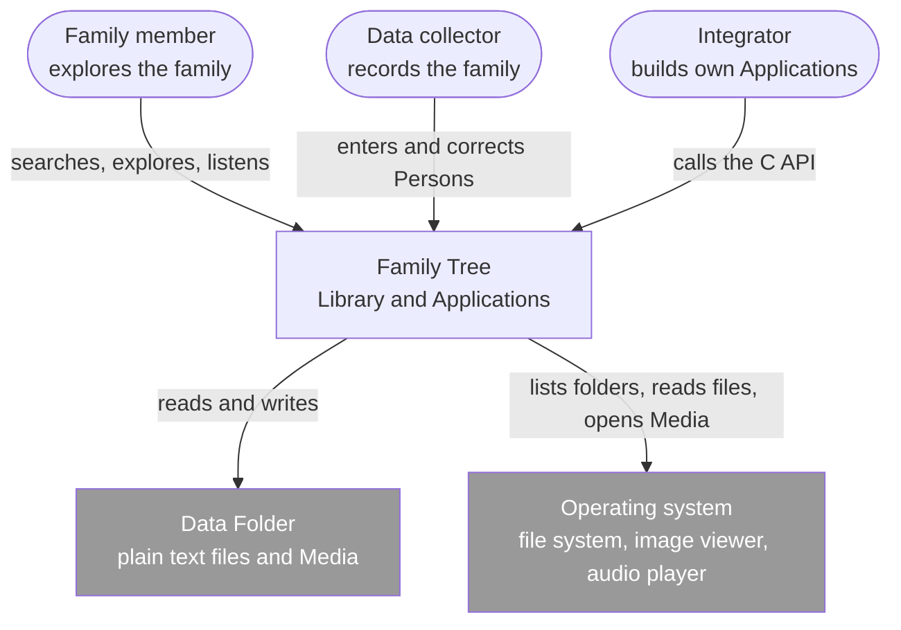
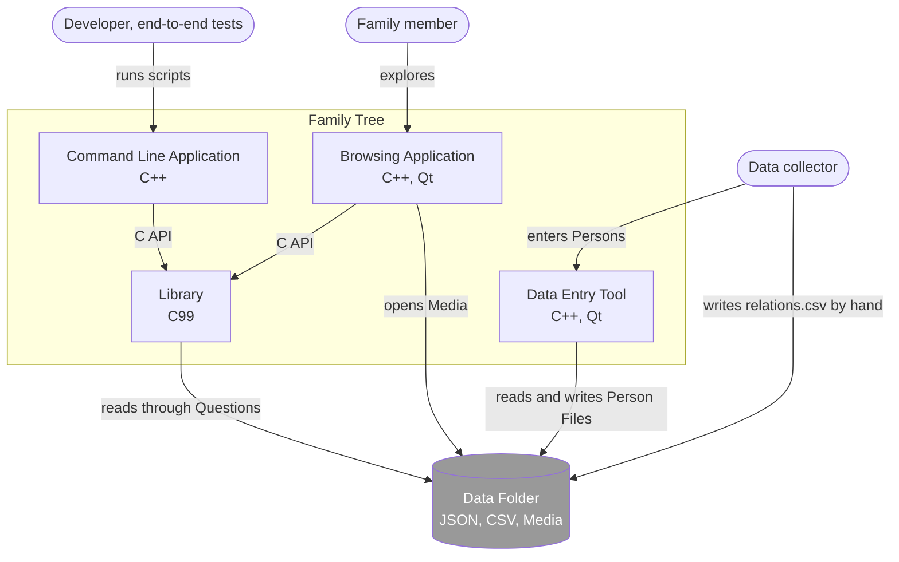
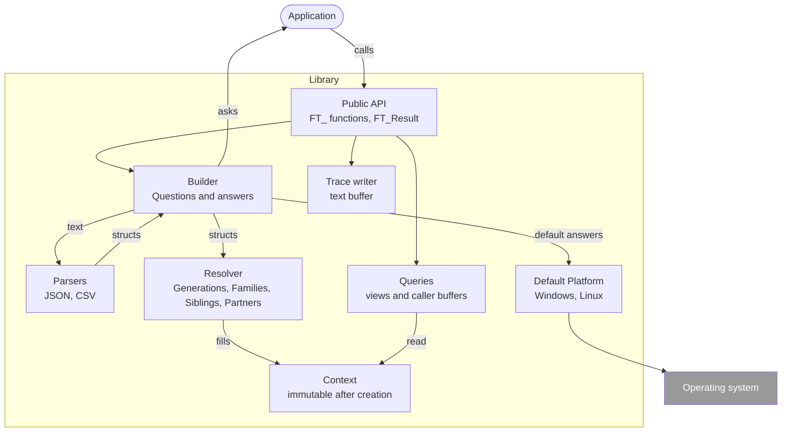
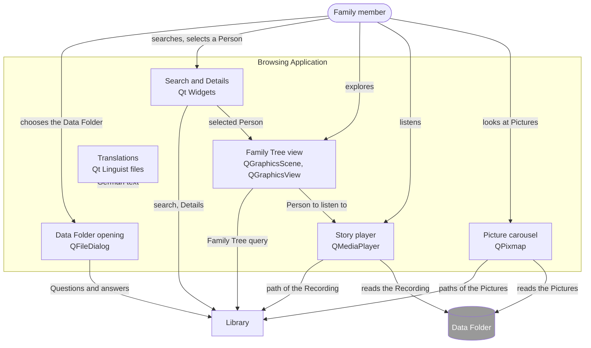
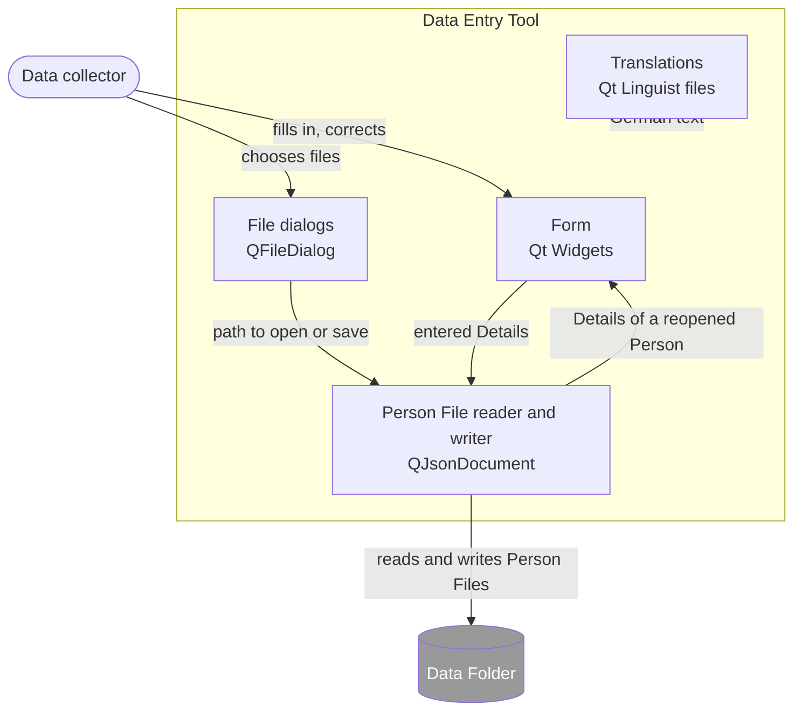

# Family Tree Architecture

## Context
<!-- The system as a single box: the people who use it and the external systems it interacts with. -->

| Name | Type | Description |
| ---: | :--- | :--- |
| Family member | Person | explores the family with the Browsing Application: searches, looks at Details, Pictures and the Family Tree, listens to Recordings |
| Data collector | Person | records the family with the Data Entry Tool; may only speak German |
| Integrator | Person | builds an own Application on the Library |
| Future maintainer | Person | revives the project after a long time; reads the records and builds the Library with nothing but a C99 compiler |
| Family Tree | System | the Library and the Applications of this project |
| Data Folder | External System | the family's data as plain text files and Media, see [ADR 0001](decisions/adr_0001.md) |
| Operating system | External System | lists folders, reads files, and opens Media with its default programs |

## Containers
<!-- The separately runnable or deployable parts of the system (applications, services, databases, ...), their technology, and how they communicate. -->

| Name | Technology | Description |
| ---: | :--- | :--- |
| Library | C99, no dependencies | reads a Data Set into an immutable Context and answers every question about it, see [ADR 0002](decisions/adr_0002.md) and [ADR 0003](decisions/adr_0003.md) |
| Browsing Application | C++, Qt | search, Details, Family Tree, picture carousel and story player for family members, see [ADR 0010](decisions/adr_0010.md) |
| Data Entry Tool | C++, Qt | form to enter and correct Person Files, in German; works on the Person Files directly, without the Library |
| Command Line Application | C++ | runs scripts of commands against the Library; for development and end-to-end tests, see [ADR 0012](decisions/adr_0012.md) |
| Data Folder | JSON, CSV, image and audio files | the family's data, see [ADR 0001](decisions/adr_0001.md) |

## Components
<!-- The main building blocks of the system, their responsibilities, and how they connect to each other, to the users and to external systems. With containers: one subsection per container. -->
### Library

| Name | Technology | Description |
| ---: | :--- | :--- |
| Public API | C99 headers in `include/family_tree/` | every function returns `FT_Result` and takes an optional `FT_Trace`, see [ADR 0008](decisions/adr_0008.md) |
| Builder | module | asks the Questions needed to read a Data Set, checks every answer, has the text parsed, and hands the parsed structs to the Resolver, see [ADR 0005](decisions/adr_0005.md) |
| Parsers | module | parse the text of Person Files and Relations Files and return their content as structs, without knowing about Contexts or other files; written by hand without external code |
| Resolver | module | computes Parents, Children, Siblings, Partners, Families and Generations iteratively, and detects conflicting Generations |
| Context | data structure | holds the Data Set and everything derived from it; read only after creation, see [ADR 0003](decisions/adr_0003.md) |
| Queries | module | return views into the Context, or fill caller buffers, see [ADR 0004](decisions/adr_0004.md); includes the Family Tree query, see [ADR 0009](decisions/adr_0009.md) |
| Default Platform | module | answers Questions on Windows and Linux, and opens Media with the default programs, see [ADR 0006](decisions/adr_0006.md) |
| Trace writer | module | appends lines to the Application's text buffer, compacts every Subtrace that closes without an error, and drops the oldest lines when the buffer is full, see [ADR 0018](decisions/adr_0018.md) |

### Browsing Application

| Name | Technology | Description |
| ---: | :--- | :--- |
| Data Folder opening | QFileDialog | lets the user choose the Data Folder, creates the Context through the Questions, and shows warnings and errors in German |
| Search and Details | Qt Widgets | search form, list of Persons found, all Details of a selected Person |
| Family Tree view | QGraphicsScene, QGraphicsView | draws the Family Tree; the layout within the rows is investigated in [SPK 0001](spikes/spk_0001.md) |
| Story player | QMediaPlayer | plays, pauses and continues Recordings |
| Picture carousel | QPixmap | shows the Pictures of a Person one at a time |
| Translations | Qt Linguist files | all text of the user interface, German first |

### Data Entry Tool

| Name | Technology | Description |
| ---: | :--- | :--- |
| Form | Qt Widgets | every Detail, the Person Id and the Media references of a Person |
| Person File reader and writer | QJsonDocument | the class `PersonFileDocument`: reads a Person File into the form, and writes it in the current Format Version; keeps the keys it does not know, which the structs of the Library would drop. Its interface uses standard C++ types only, so it is tested without the form |
| File dialogs | QFileDialog | choose the Person File to open, and where to save it |
| Translations | Qt Linguist files | all text of the user interface, German first |

## Interfaces
<!-- The most important high-level interfaces between containers or components, or to external systems. -->
| Interface | Provider | Consumers | Protocol | Description |
| ---: | :--- | :--- | :--- | :--- |
| Public API | Library | Applications | C function calls | creating, querying and freeing a Context; see the overview below, and [ADR 0017](decisions/adr_0017.md) for the signatures |
| Questions | Library | Applications | C function calls, `FT_StartCreate` and `FT_Continue` | the Library asks for folders, files and parsed content while it creates a Context, see [ADR 0005](decisions/adr_0005.md) |
| Trace | Library | Applications | text buffer | lines of level, function and message, see [ADR 0018](decisions/adr_0018.md) |
| Person File | Data Entry Tool, data collector | Library | JSON file, UTF-8 | see [REQ 0002](requirements/req_0002.md) and [REQ 0003](requirements/req_0003.md) |
| Relations File | data collector | Library | CSV file, UTF-8 | see [REQ 0006](requirements/req_0006.md) and [REQ 0007](requirements/req_0007.md) |
| Commands | Command Line Application | end-to-end tests | text on the standard input and output | see [ADR 0012](decisions/adr_0012.md) |

### Public API of the Library
The functions of the Library, by group. The full signatures are in the public header [api.h](../library/include/family_tree/api.h), see [ADR 0017](decisions/adr_0017.md).

| Group | Function | Purpose |
| ---: | :--- | :--- |
| Creation | `FT_Create` | creates a Context from a Data Folder in one call, with the Default Platform |
| Creation | `FT_StartCreate`, `FT_Continue` | create a Context through Questions the Application answers |
| Creation | `FT_CancelCreate` | stops a creation that is not over |
| Creation | `FT_Free` | frees a Context and everything it returned |
| Upper bounds | `FT_GetPersonCount`, `FT_GetFamilyCount` | the sizes every caller buffer can be allocated with |
| Views | `FT_GetPerson` | all Details of a Person |
| Views | `FT_GetRelations` | the Relations of a Person |
| Views | `FT_GetParents`, `FT_GetChildren`, `FT_GetSiblings`, `FT_GetPartners` | the closest relatives of a Person |
| Views | `FT_GetFamiliesOf`, `FT_GetFamily` | the Families of a Person, and the members of a Family |
| Views | `FT_GetPicturePaths`, `FT_GetRecordingPath` | the paths of the Media of a Person |
| Values | `FT_GetRelativeGeneration` | the Generation of a Person relative to another |
| Values | `FT_IsDefaultString` | whether a Detail is the default string, i.e. missing in the Person File |
| Buffer queries | `FT_Search` | the Persons matching a search; without search texts and with a minimum of 0, every Person |
| Buffer queries | `FT_GetCommonParents`, `FT_GetCommonChildren` | the Parents or Children a set of Persons have in common |
| Buffer queries | `FT_GetFamilyTree` | the Persons and Families of the Family Tree around a Person |
| Media defaults | `FT_DefaultShowPicture`, `FT_DefaultPlayRecording` | open a Picture or a Recording with the program of the operating system |
| Media defaults | `FT_ShowPicturesOfPerson`, `FT_PlayRecordingOfPerson` | look up the Media of a Person and open them the default way, in one call |

## See Also
 - [ADR 0017](decisions/adr_0017.md) the full Public API of the Library
 - [ADR 0002](decisions/adr_0002.md) why the Library is C99 and the Applications are free
 - [ADR 0011](decisions/adr_0011.md) the rules the Library's code follows
