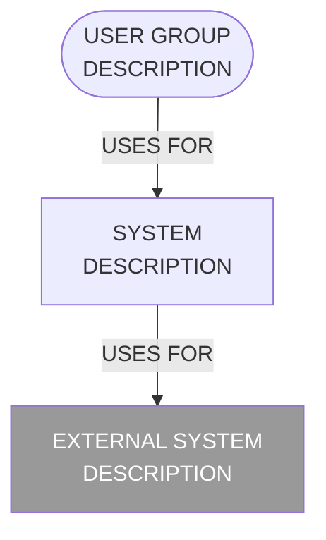
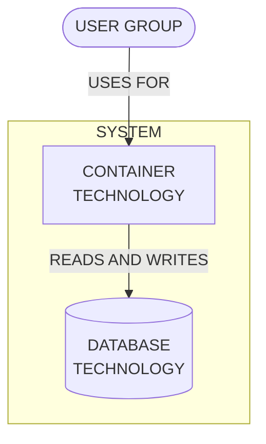
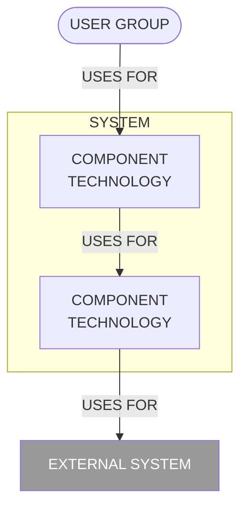

# <!-- PROJECT NAME --> Architecture

## Context
<!-- The system as a single box: the people who use it and the external systems it interacts with. -->

<!-- TEMPLATE
| Name | Type | Description |
| ---: | :--- | :--- |
| NAME | Person, System, OR External System | what it is and how it relates to the system |
-->

<!-- ## Containers
only if the system consists of more than one runnable part -->
<!-- The separately runnable or deployable parts of the system (applications, services, databases, ...), their technology, and how they communicate. -->

<!-- TEMPLATE
| Name | Technology | Description |
| ---: | :--- | :--- |
| NAME | language, framework, OR product | what it is responsible for |
-->

## Components
<!-- The main building blocks of the system, their responsibilities, and how they connect to each other, to the users and to external systems. With containers: one subsection per container. -->

<!-- TEMPLATE
| Name | Technology | Description |
| ---: | :--- | :--- |
| NAME | module, class, OR library | what it is responsible for |
-->

## Interfaces
<!-- The most important high-level interfaces between containers or components, or to external systems. -->
<!-- TEMPLATE
| Interface | Provider | Consumers | Protocol | Description |
| ---: | :--- | :--- | :--- | :--- |
| NAME | CONTAINER OR COMPONENT | CONTAINERS OR COMPONENTS | e.g. REST, gRPC, file, message queue | what is exchanged, and a link to the detailed specification |
-->

<!-- TEMPLATE
## See Also
 - [ADR 0000](decisions/adr_0000.md) reason why this is related
-->
