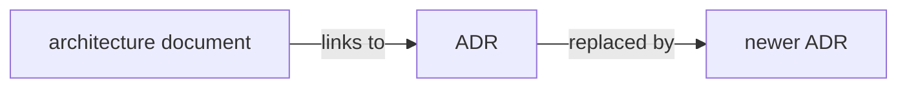

# Example Architecture Decision Record
## Context
<!-- The situation and the forces that make a decision necessary. -->
The architecture document described not only what the system looks like, but also why it was built that way and how individual parts work in detail. Over time this made it messy, and the reasons behind older decisions got lost between the descriptions.

## Design
<!-- The parts involved, their responsibilities, and how they work together, e.g. as a flowchart or sequence diagram. -->

| Part | Responsibility |
| ---: | :--- |
| architecture document | describes the current high-level structure of the system, but not why it is built that way |
| ADR | describes one part of the system in detail, and why it is built that way |

## Justification
<!-- A sound reasoning why this design was chosen, including the conditions under which it holds. -->
A decision never changes once it is made, while the architecture document always has to show the current state. Keeping both in one document means one of them is always out of date.

## Consequences
<!-- What becomes easier or harder because of this design, including new obligations and risks. -->
The architecture document stays short and readable. In return there is one more document type to maintain, and it has to be linked from the architecture document to be found.

## See Also
 - [ADR 0000](adr_0000.md) to see an example of an ADR

-----
## Discussions
<!-- TEMPLATE
### Topic
NAME
> COMMENT
-->
### I was linked here
Andreas Edmeier
> If you end up here for another ADR then most probably the link was not properly set up.
