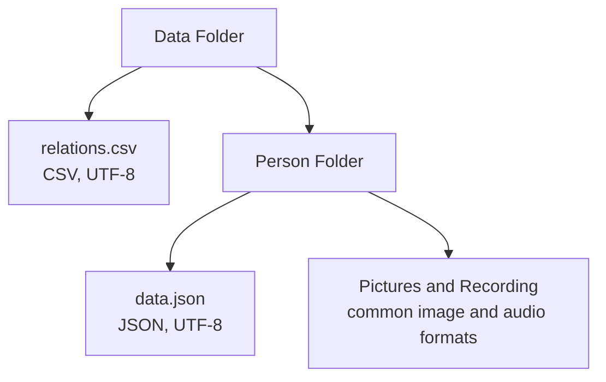

# Plain text data files
## Context
<!-- The situation and the forces that make a decision necessary. -->
The data of a family has to stay readable for decades, also when no program is left that understands it. The author keeps a printed copy of the data, and the Recordings on vinyl records, for exactly that reason. The format of the Person File changed early in the project, so every format has to be able to change again ([REQ 0002](../requirements/req_0002.md), [REQ 0006](../requirements/req_0006.md)).

## Design
<!-- The parts involved, their responsibilities, and how they work together, e.g. as a flowchart or sequence diagram. -->

| Part | Responsibility |
| ---: | :--- |
| Data Folder | a plain folder; its structure is the only index of the Data Set |
| Person File | one JSON file per Person, with its Format Version in the key "Version" |
| Relations File | one CSV file per Data Folder, with its Format Version in the first line and a header in the second |
| Media | image and audio files in formats that common programs open; the Library never reads their content, only their paths |

## Justification
<!-- A sound reasoning why this design was chosen, including the conditions under which it holds. -->
Plain text can be read with any text editor, printed, compared line by line, and kept under version control. It needs no program of this project to be understood, which is the only kind of format that can outlive the project. JSON and CSV are the most widespread plain text formats for records and for tables, and both can be written by hand.

## Consequences
<!-- What becomes easier or harder because of this design, including new obligations and risks. -->
The Library has to parse JSON and CSV itself, because it may not use external code. There is no database and no index, so the whole Data Set is read when a Context is created. Files edited by hand can be malformed, which the Library has to survive. Every change to a format needs a new Format Version. JSON allows no line breaks within a string, so texts with several lines, e.g. the remarks, are arrays with one string per line; an escape sequence like `\n` would mean nothing to a reader who does not know JSON.

## See Also
 - [ADR 0002](adr_0002.md) Library in C99, Applications free
 - [ADR 0005](adr_0005.md) Questions instead of callbacks

-----
## Discussions
<!-- TEMPLATE
### Topic
NAME
> COMMENT
-->
