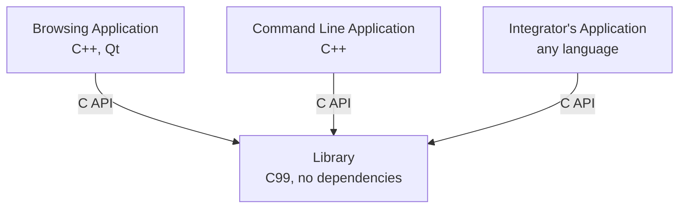

# Library in C99, Applications free
## Context
<!-- The situation and the forces that make a decision necessary. -->
The project is meant to be shelved for decades and still get running again ([REQ 0035](../requirements/req_0035.md), [REQ 0036](../requirements/req_0036.md), [REQ 0039](../requirements/req_0039.md)). Most of its value lies in the Library, which understands the data. The Applications are a bonus on top of it, and user interface toolkits age much faster than a language like C. The original implementation already decided this in 2024: its decision records chose C99 for the Library, and forbade external code in it.

## Design
<!-- The parts involved, their responsibilities, and how they work together, e.g. as a flowchart or sequence diagram. -->

| Part | Responsibility |
| ---: | :--- |
| Library | C99 sources and public headers; uses nothing but the C standard library and the operating system; builds with a single compiler call |
| Applications | any language and any dependencies; talk to the Library only through its public C API |
| CMake | a convenience to build everything; the Library never depends on it |

## Justification
<!-- A sound reasoning why this design was chosen, including the conditions under which it holds. -->
C is widespread and likely to survive; C compilers are archived, e.g. in the GitHub Arctic Code Vault; a C compiler can be written from scratch; and C code can be translated by hand into a more modern language. Almost every language can call a C API, so any future Application can use the Library. Dependencies disappear over time, so the part that has to survive has none. The Applications can be rewritten on top of the Library whenever their toolkit stops working.

## Consequences
<!-- What becomes easier or harder because of this design, including new obligations and risks. -->
The Library implements its JSON parser, CSV parser and graph algorithms itself. The Applications may stop building when their dependencies age, while the Library and the data stay usable. The Library's sources must not need a configure step or generated code, so that they also build without CMake.

## See Also
 - [ADR 0010](adr_0010.md) Applications in C++ with Qt
 - [ADR 0011](adr_0011.md) Power of Ten rules for the Library

-----
## Discussions
<!-- TEMPLATE
### Topic
NAME
> COMMENT
-->
