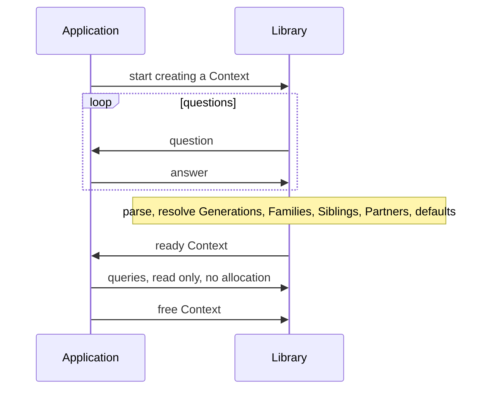

# Immutable Context
## Context
<!-- The situation and the forces that make a decision necessary. -->
The original implementation computed most results on every call, and kept every array it returned alive until the Context was freed, so memory grew with every call. Its generation algorithm was recursive and ran out of stack on conflicting data. The data does not change while it is viewed. NASA's Power of Ten rules for mission critical code forbid dynamic memory allocation after initialization.

## Design
<!-- The parts involved, their responsibilities, and how they work together, e.g. as a flowchart or sequence diagram. -->

| Part | Responsibility |
| ---: | :--- |
| Creation | reads the Data Set through questions, parses it, and computes everything derived from it: Parents, Children, Siblings, Partners, Families, Generations and the default values of missing Details; the only phase that allocates memory |
| Context | after creation read only; every query takes it as `const` |
| Free | releases the Context with everything it holds, in one call |

## Justification
<!-- A sound reasoning why this design was chosen, including the conditions under which it holds. -->
Computing everything once is cheap for families of hundreds or thousands of Persons, and makes every later query a lookup. A Context that never changes cannot leak memory per call, has a memory use that is known after creation, and can be read from several threads at once. Conflicting Generations are found once, at creation, where they can stop the creation ([REQ 0047](../requirements/req_0047.md)).

## Consequences
<!-- What becomes easier or harder because of this design, including new obligations and risks. -->
Creating a Context takes longer, and holds all derived data from the start. A change of the data needs a new Context, e.g. after the Data Entry Tool saved a Person File. Every algorithm that runs at creation has to be iterative ([REQ 0045](../requirements/req_0045.md)).

## See Also
 - [ADR 0004](adr_0004.md) Results as views and caller buffers
 - [ADR 0005](adr_0005.md) Questions instead of callbacks
 - [ADR 0011](adr_0011.md) Power of Ten rules for the Library

-----
## Discussions
<!-- TEMPLATE
### Topic
NAME
> COMMENT
-->
