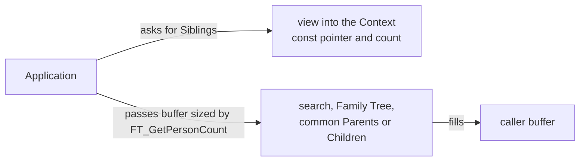

# Results as views and caller buffers
## Context
<!-- The situation and the forces that make a decision necessary. -->
The original implementation allocated every array it returned and kept it alive until the Context was freed. The common alternative, calling a function once to get the size and again to get the data, computes everything twice. The Context is immutable after its creation, and allocates nothing afterwards.

## Design
<!-- The parts involved, their responsibilities, and how they work together, e.g. as a flowchart or sequence diagram. -->


| Part | Responsibility |
| ---: | :--- |
| View | a `const` pointer and a count into data the Context already holds, e.g. the Siblings, Partners, Relations or Families of a Person, or the Details of a Person; valid until the Context is freed |
| Caller buffer | memory the Application provides for results that depend on parameters, e.g. a search or a Family Tree; filled in a single call |
| Upper bounds | `FT_GetPersonCount` and `FT_GetFamilyCount`; no result can be larger, so a buffer of that size always fits |
| Too small buffer | the call fails with an error and fills nothing |

Example of both kinds:

```c
const FT_PersonId* siblings = NULL;
size_t siblingCount = 0;
FT_Result result = FT_GetSiblings(context, person, &siblings, &siblingCount, &trace);

size_t capacity = 0;
result = FT_GetPersonCount(context, &capacity, &trace);   /* once, after creating the Context */
FT_PersonId* found = malloc(capacity * sizeof(FT_PersonId));
size_t foundCount = 0;
result = FT_Search(context, &prototype, 1, found, capacity, &foundCount, &trace);
```

## Justification
<!-- A sound reasoning why this design was chosen, including the conditions under which it holds. -->
Views cost nothing, because the data already exists. Caller buffers are filled in a single call, because their largest possible size is known before the call. The Library keeps no memory alive for a call, so freeing the Context releases everything it ever returned ([REQ 0042](../requirements/req_0042.md)).

## Consequences
<!-- What becomes easier or harder because of this design, including new obligations and risks. -->
An Application must not use a view after freeing the Context. Caller buffers are usually larger than needed; with thousands of Persons, that is a few kilobytes. Every function documents whether it returns a view or fills a buffer.

## See Also
 - [ADR 0017](adr_0017.md) the full Public API
 - [ADR 0003](adr_0003.md) Immutable Context
 - [ADR 0008](adr_0008.md) Result codes, warnings and errors
 - [ADR 0009](adr_0009.md) Family Tree query

-----
## Discussions
<!-- TEMPLATE
### Topic
NAME
> COMMENT
-->
