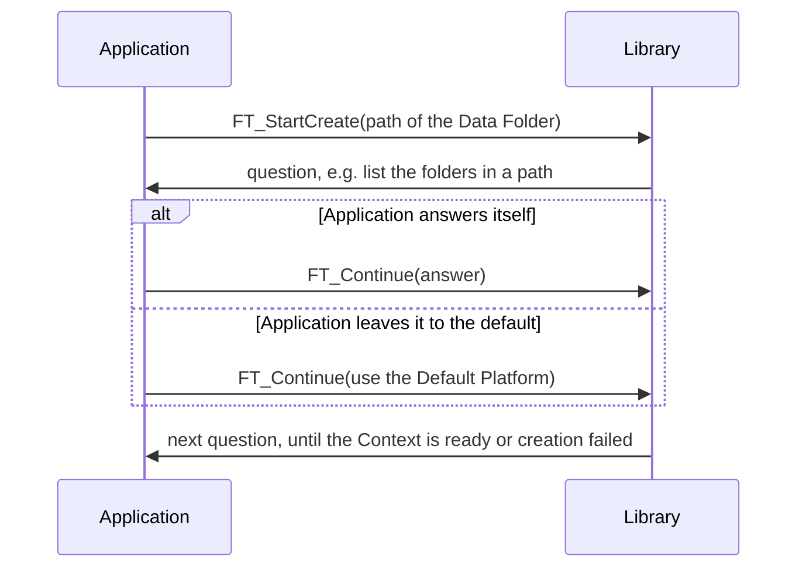

# Questions instead of callbacks
## Context
<!-- The situation and the forces that make a decision necessary. -->
The Library has to reach the operating system through a replaceable Platform ([REQ 0037](../requirements/req_0037.md)). The original implementation did this with an interface of function pointers. NASA's Power of Ten rules forbid function pointers. The partial rewrite replaced the interface with questions the Library asks and the Application answers, but left showing Pictures and playing Recordings unsolved; see [ADR 0006](adr_0006.md) for those.

## Design
<!-- The parts involved, their responsibilities, and how they work together, e.g. as a flowchart or sequence diagram. -->

| Part | Responsibility |
| ---: | :--- |
| Question | what the Library needs next: the folders in a path, whether a file exists, the content of a file, or the parsed content of a Person File or a Relations File |
| Answer | given by the Application with the next call to `FT_Continue`; the Library copies what it needs before that call returns, so the Application can release its memory right away |
| Default Platform | answers every question on Windows and Linux, when the Application asks for the default |
| Parsing questions | let an Application parse a file itself, e.g. a data format a future maintainer adds, without changing the Library |

## Justification
<!-- A sound reasoning why this design was chosen, including the conditions under which it holds. -->
Questions keep the control flow in the Application and need no function pointers. An Application can read the Data Set from any storage, e.g. an archive or a medium that does not exist yet, by answering the questions itself, while a simple Application leaves every answer to the Default Platform. The questions only exist while a Context is created, because the Context never reads anything afterwards ([ADR 0003](adr_0003.md)).

## Consequences
<!-- What becomes easier or harder because of this design, including new obligations and risks. -->
Creating a Context is a loop in the Application instead of a single call. The set of question types is part of the public API and changes only with care. The Library has to check every answer, because it comes from outside.

## See Also
 - [ADR 0003](adr_0003.md) Immutable Context
 - [ADR 0006](adr_0006.md) Media paths instead of showing and playing

-----
## Discussions
<!-- TEMPLATE
### Topic
NAME
> COMMENT
-->
