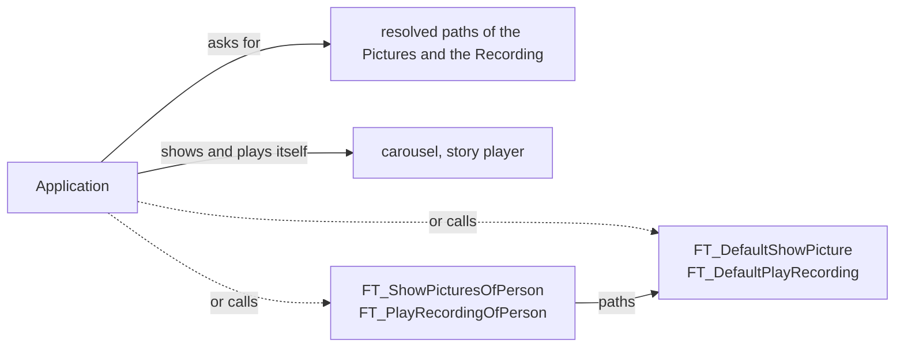

# Media paths instead of showing and playing
## Context
<!-- The situation and the forces that make a decision necessary. -->
The original implementation showed Pictures and played Recordings through the Platform, by function pointers the Application could replace. Without function pointers ([ADR 0005](adr_0005.md)), the Library cannot call back into the Application. The Browsing Application shows Pictures in a carousel and plays Recordings in its own player anyway ([REQ 0048](../requirements/req_0048.md), [REQ 0012](../requirements/req_0012.md)).

## Design
<!-- The parts involved, their responsibilities, and how they work together, e.g. as a flowchart or sequence diagram. -->

| Part | Responsibility |
| ---: | :--- |
| Media paths | the Library resolves the paths relative to the Person Folder at creation, asks whether each file exists, and reports missing ones as warnings; queries return the paths of existing files as views |
| Default functions | open a Picture or a Recording with the program the operating system uses for it, on Windows and Linux; the only place where the Library starts another program |
| Convenience functions | look up the paths of a Person's Media and hand them to the default functions in one call, as the original implementation did with `ShowImagesOfPerson` and `PlayPerson` |
| Application | decides what to do with the paths |

## Justification
<!-- A sound reasoning why this design was chosen, including the conditions under which it holds. -->
Returning paths needs no callback, and gives every Application full freedom over how it shows Media. Applications that do not care get the same behavior as the original implementation, in one call, through the convenience functions. Checking the files at creation reports missing Media once ([REQ 0025](../requirements/req_0025.md)), instead of on every attempt to open them.

## Consequences
<!-- What becomes easier or harder because of this design, including new obligations and risks. -->
[REQ 0023](../requirements/req_0023.md) and [REQ 0024](../requirements/req_0024.md) describe paths and default functions instead of showing and playing through the Platform. A Media file that is deleted after the Context was created is only noticed by whoever opens it.

## See Also
 - [ADR 0005](adr_0005.md) Questions instead of callbacks

-----
## Discussions
<!-- TEMPLATE
### Topic
NAME
> COMMENT
-->
