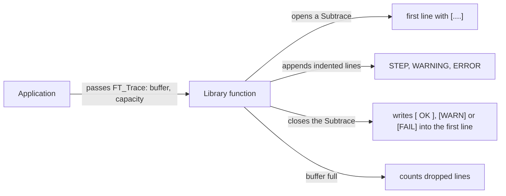

# Trace as a text buffer
## Context
<!-- The situation and the forces that make a decision necessary. -->
The original implementation passed a Trace object of function pointers to every function, and created a no-op Trace when none was given. Function pointers are forbidden ([ADR 0011](adr_0011.md)), and the Context allocates nothing after its creation ([ADR 0003](adr_0003.md)). The Trace viewer of the original implementation was needed because its log format was hard to read ([REQ 0044](../requirements/req_0044.md)). What made the original Trace valuable were its Subtraces: each showed whether it succeeded, so a successful branch could be skipped without reading it, while, unlike a stack trace, every path the code took stayed visible.

## Design
<!-- The parts involved, their responsibilities, and how they work together, e.g. as a flowchart or sequence diagram. -->


| Part | Responsibility |
| ---: | :--- |
| FT_Trace | a struct of a character buffer, its capacity, the number of characters used, the number of dropped lines, and the positions of the open Subtraces, up to a depth of 32; provided by the Application, filled with zeros except for the buffer and its capacity |
| Subtrace | one task of the Library, e.g. reading a Person File; its first line holds its outcome, the function and a short description; its lines are indented by one tab per depth |
| Outcome | `[....]` while the Subtrace is open; then `[ OK ]`, `[WARN]` or `[FAIL]`, written into the first line when the Subtrace closes; a Subtrace takes the worst outcome of everything inside it |
| Line | one report within a Subtrace: the level (STEP, WARNING or ERROR) and the message |
| Separators | tabs, for the indentation and between the fields of a line, so that a line can be split into its fields, and indentation costs one byte per depth |
| No Trace | a null pointer or a capacity of 0; the public function replaces it with an empty Trace on entry, so internal functions never check for it |

Example:

```
[WARN]	FT_Create	/home/vater/Familie
	[ OK ]	ReadRelationsFile	relations.csv
		STEP	18 Relations read
	[WARN]	ReadPersonFiles	18 Person Folders
		[ OK ]	ReadPersonFile	2_Katy_Santos/data.json
		[WARN]	ReadPersonFile	1_Philippa_Perry/data.json
			WARNING	unknown key "death"
	[ OK ]	ResolveGenerations
		STEP	3 Family Graphs, 5 Generations
```

## Justification
<!-- A sound reasoning why this design was chosen, including the conditions under which it holds. -->
A buffer needs no function pointer and no allocation. Plain text lines can be read without any tool, written to a file, and searched with standard tools. Writing the outcome into the first line keeps the strength of the original Trace: the outcome is visible without reading the Subtrace, and editors that fold by indentation show exactly the first lines with their outcomes, which may make the Trace viewer unnecessary. A Subtrace that still shows `[....]` after a crash shows where the Library stopped. The outcome field has a fixed width, so it can be filled in later without moving text. A Trace of capacity 0 discards everything, which is exactly the behavior without a Trace.

## Consequences
<!-- What becomes easier or harder because of this design, including new obligations and risks. -->
The Application chooses the size of the buffer, and loses lines when it is too small; the count of dropped lines tells it so, and the outcomes of Subtraces already written are still filled in. Subtraces deeper than 32 are not indented further and count as dropped; the rule against recursion keeps the depth far below that. The Library formats text, which costs a little time even when nobody reads it; reports are only formatted when there is room for them.

## See Also
 - [ADR 0008](adr_0008.md) Result codes, warnings and errors
 - [ADR 0011](adr_0011.md) Power of Ten rules for the Library

-----
## Discussions
<!-- TEMPLATE
### Topic
NAME
> COMMENT
-->
