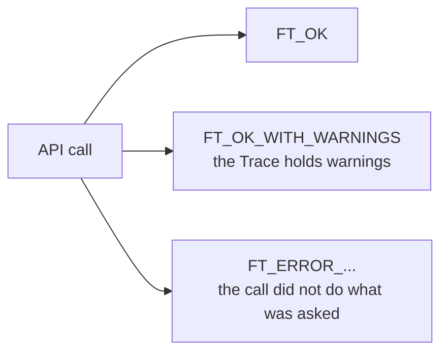

# Result codes, warnings and errors
## Context
<!-- The situation and the forces that make a decision necessary. -->
The Library has to tell the Application whether a call worked, and the Trace has to tell steps, warnings and errors apart ([OQ 0019](../open_questions.md)). [REQ 0008](../requirements/req_0008.md) asks for warnings, and [REQ 0047](../requirements/req_0047.md) for telling the Application that a Context could not be created.

## Design
<!-- The parts involved, their responsibilities, and how they work together, e.g. as a flowchart or sequence diagram. -->

| Part | Responsibility |
| ---: | :--- |
| Step | what the Library did, to follow its flow, e.g. reading a Person File |
| Warning | a problem in the data that the Library worked around, while the call still did what was asked, e.g. a skipped Person File, an unknown key, an unknown Relation Type, or a missing Media file |
| Error | the call could not do what was asked, e.g. conflicting Generations, an unknown Person Id, a buffer that is too small, or no memory left |
| FT_Result | the return value of every public function; results are returned through output parameters |

## Justification
<!-- A sound reasoning why this design was chosen, including the conditions under which it holds. -->
One return type for every function makes checking it a habit, as the Power of Ten rules demand ([ADR 0011](adr_0011.md)). Telling warnings from errors lets an Application say "opened, but 2 files were skipped" without reading the Trace, while the Trace says which files.

## Consequences
<!-- What becomes easier or harder because of this design, including new obligations and risks. -->
Every public function returns `FT_Result`, so even simple lookups return their value through an output parameter. A new kind of error needs a new value of `FT_Result`.

## See Also
 - [ADR 0007](adr_0007.md) Trace as a text buffer

-----
## Discussions
<!-- TEMPLATE
### Topic
NAME
> COMMENT
-->
