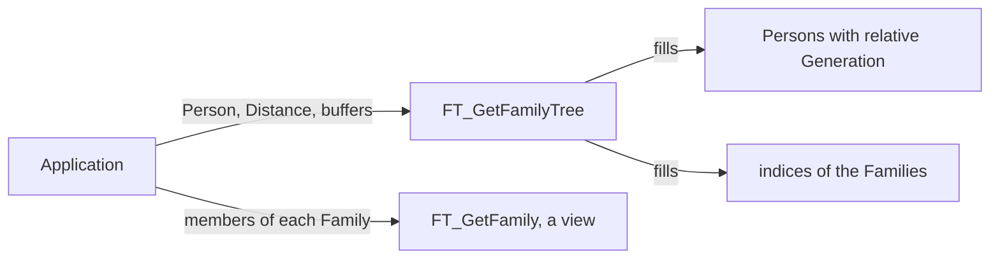

# Family Tree query
## Context
<!-- The situation and the forces that make a decision necessary. -->
The original implementation offered a helper that built the Family Tree around a Person, and called back into the Application for every Person and Family. Every part of it can also be built from the other functions of the API. The helper is convenient, but its callbacks are forbidden now ([REQ 0022](../requirements/req_0022.md)).

## Design
<!-- The parts involved, their responsibilities, and how they work together, e.g. as a flowchart or sequence diagram. -->

| Part | Responsibility |
| ---: | :--- |
| FT_GetFamilyTree | walks from the Families of the Person from Family to Family up to the Distance, and fills the caller's buffers |
| Persons buffer | every Person of the Family Tree with their Generation relative to the given Person, including the given Person; at most `FT_GetPersonCount` entries |
| Families buffer | the index of every Family of the Family Tree; at most `FT_GetFamilyCount` entries |
| FT_GetFamily | a view of the Parents and Children of a Family, which already exist in the Context |

## Justification
<!-- A sound reasoning why this design was chosen, including the conditions under which it holds. -->
The Family Tree is what most Applications want to show, and the walk from Family to Family is easy to get wrong, as the original implementation showed by tearing Families apart. Offering it once in the Library keeps every Application from repeating it. It stays a convenience: nothing in it is out of reach of the other functions.

## Consequences
<!-- What becomes easier or harder because of this design, including new obligations and risks. -->
The Application still has to place the Persons within their row; the Library only provides the rows through the Generations. How to lay them out is investigated in [SPK 0001](../spikes/spk_0001.md).

## See Also
 - [ADR 0020](adr_0020.md) the signature of `FT_GetFamilyTree`
 - [ADR 0004](adr_0004.md) Results as views and caller buffers

-----
## Discussions
<!-- TEMPLATE
### Topic
NAME
> COMMENT
-->
