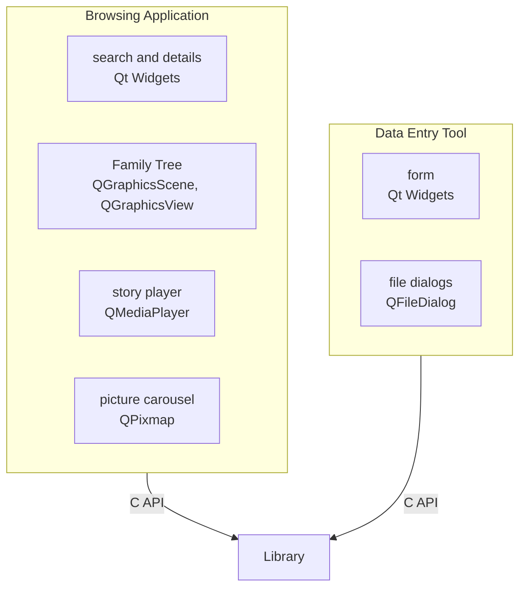

# Applications in C++ with Qt
## Context
<!-- The situation and the forces that make a decision necessary. -->
The original Applications used C++ with Dear ImGui. Positioning the boxes of the Family Tree turned out to be very hard in it: an immediate mode toolkit leaves every position, text measurement, zoom, scroll and click to the Application. The Browsing Application now also needs a story player and a picture carousel, and both Applications need German text that can be translated. The author is fluent in C++.

## Design
<!-- The parts involved, their responsibilities, and how they work together, e.g. as a flowchart or sequence diagram. -->

| Part | Responsibility |
| ---: | :--- |
| Qt Widgets | windows, forms, lists and native file dialogs |
| Graphics scene | the boxes and lines of the Family Tree as objects with positions; Qt sizes them to their text and handles zoom, scrolling and clicks |
| QMediaPlayer | plays, pauses and continues Recordings inside the Browsing Application |
| Qt Linguist translations | all text of the user interface in plain text translation files, German first |

## Justification
<!-- A sound reasoning why this design was chosen, including the conditions under which it holds. -->
Qt brings a retained mode graphics scene, an audio player, image loading, native dialogs and translation files, which together cover every need of the Applications. Staying with C++ means learning one toolkit instead of a language and a toolkit. Qt has been maintained for three decades, which is long for a user interface toolkit.

## Consequences
<!-- What becomes easier or harder because of this design, including new obligations and risks. -->
Qt is a large dependency, and its LGPL license requires linking it dynamically. Building the Applications needs a Qt installation. The layout of the Family Tree is still an algorithm the Browsing Application has to provide; it is investigated in [SPK 0001](../spikes/spk_0001.md).

## See Also
 - [ADR 0002](adr_0002.md) Library in C99, Applications free
 - [ADR 0009](adr_0009.md) Family Tree query

-----
## Discussions
<!-- TEMPLATE
### Topic
NAME
> COMMENT
-->
