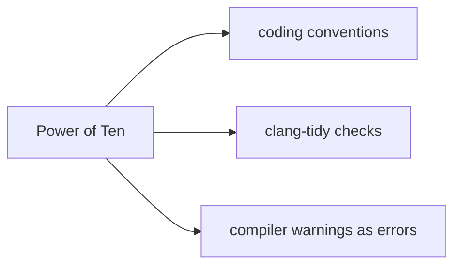

# Power of Ten rules for the Library
## Context
<!-- The situation and the forces that make a decision necessary. -->
Mistakes in C code are easy to make and hard to find, e.g. memory leaks, which plagued the original implementation. The Library has to survive decades and malformed data without crashing. The author follows NASA's coding rules for mission critical code, the Power of Ten by Gerard Holzmann.

## Design
<!-- The parts involved, their responsibilities, and how they work together, e.g. as a flowchart or sequence diagram. -->

| Part | Responsibility |
| ---: | :--- |
| Rule 1 | simple control flow: no goto, no setjmp, no recursion |
| Rule 2 | every loop has a fixed upper bound, e.g. the number of Persons |
| Rule 3 | no dynamic memory allocation after the Context is created |
| Rule 4 | no function longer than 60 lines |
| Rule 5 | assertions check the preconditions of internal functions |
| Rule 6 | every variable is declared in the smallest possible scope |
| Rule 7 | every return value is checked, and every public function checks its parameters |
| Rule 8 | the preprocessor is used for includes, include guards and the export macro only |
| Rule 9 | no function pointers; pointers are dereferenced one level at a time, except for output parameters |
| Rule 10 | all compiler warnings are on and treated as errors, and the code passes static analysis without warnings |

## Justification
<!-- A sound reasoning why this design was chosen, including the conditions under which it holds. -->
The rules were written for code that must not fail and cannot be fixed easily once it is out of reach, which matches a Library that has to be revived after decades. Most of them can be checked by tools, so they cost little discipline once set up.

## Consequences
<!-- What becomes easier or harder because of this design, including new obligations and risks. -->
Algorithms have to be iterative, e.g. the assignment of Generations and the walk through the Family Tree. Code gets more explicit and somewhat longer. The rules apply to the Library only; the Applications follow common C++ practice.

## See Also
 - [ADR 0003](adr_0003.md) Immutable Context
 - [ADR 0005](adr_0005.md) Questions instead of callbacks
 - [ADR 0018](adr_0018.md) Compacting Trace as a text buffer

-----
## Discussions
<!-- TEMPLATE
### Topic
NAME
> COMMENT
-->
