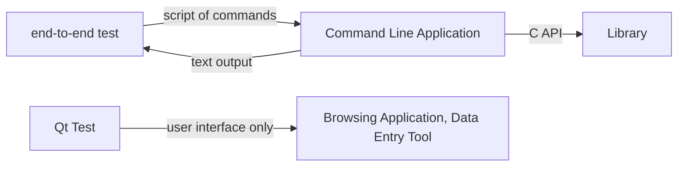

# Command line application for end-to-end tests
## Context
<!-- The situation and the forces that make a decision necessary. -->
The scenarios of the features describe what users see. Driving graphical Applications from tests is slow and fragile. The original implementation had a command line interface for development, which could also run a script of commands.

## Design
<!-- The parts involved, their responsibilities, and how they work together, e.g. as a flowchart or sequence diagram. -->

| Part | Responsibility |
| ---: | :--- |
| Command Line Application | reads commands from a script or the standard input, calls the Library, and prints the results as text |
| End-to-end tests | run scripts against test Data Folders and compare the output with the expected text |
| Qt Test | checks what only the graphical Applications do, e.g. German labels, the carousel and the story player |

## Justification
<!-- A sound reasoning why this design was chosen, including the conditions under which it holds. -->
Text in and text out is easy to automate, to read and to compare, and covers everything the scenarios expect from the Library. Only the parts that exist in the graphical Applications alone need user interface tests.

## Consequences
<!-- What becomes easier or harder because of this design, including new obligations and risks. -->
The Command Line Application has to offer a command for every Library feature a scenario uses. It is a development tool, not part of what the data collector or the family members use.

## See Also
 - [ADR 0002](adr_0002.md) Library in C99, Applications free

-----
## Discussions
<!-- TEMPLATE
### Topic
NAME
> COMMENT
-->
