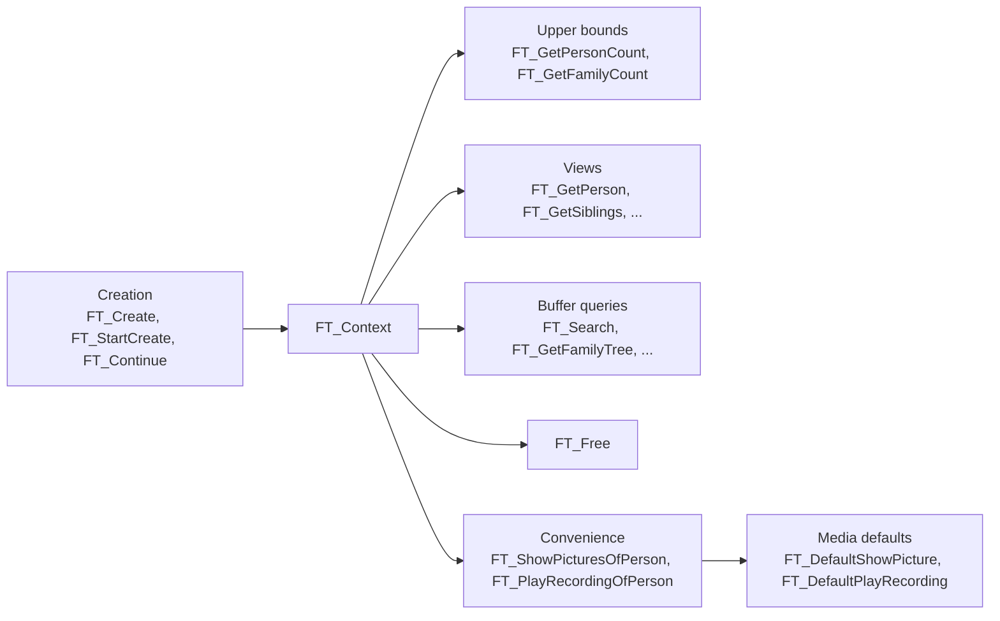

# Public API of the Library
## Context
<!-- The situation and the forces that make a decision necessary. -->
[ADR 0003](adr_0003.md) to [ADR 0009](adr_0009.md) decide how the Library is built: an immutable Context, views and caller buffers, Questions instead of callbacks, Media paths, a Trace as a text buffer, result codes, and the Family Tree query. The unit tests of step 5 need concrete functions to call, and take them from the architecture and the ADRs first. Until the public headers exist, this record is the specification of the API; afterwards, the headers are ([REQ 0043](../requirements/req_0043.md)).

## Design
<!-- The parts involved, their responsibilities, and how they work together, e.g. as a flowchart or sequence diagram. -->


| Part | Responsibility |
| ---: | :--- |
| Creation | turns a Data Folder into a Context, either in one call with the Default Platform, or through Questions the Application answers |
| Upper bounds | the sizes that every caller buffer can be allocated with once |
| Views | return `const` pointers into the Context; valid until `FT_Free` |
| Buffer queries | fill caller buffers in a single call; fail with `FT_ERROR_BUFFER_TOO_SMALL` and fill nothing if a buffer is smaller than the upper bound the function names |
| Media defaults | open a Picture or a Recording with the program of the operating system; the plain functions need no Context, the convenience functions look up the paths of a Person first |

Rules for every function:
- Every function returns `FT_Result` and takes an optional `FT_Trace*` as its last parameter; a null pointer means no Trace.
- Output parameters are only written when the function returns `FT_OK` or `FT_OK_WITH_WARNINGS`.
- All text is UTF-8 and zero terminated. Text inside the Context is never a null pointer: a missing Detail points to the Context's default string, an empty text, which `FT_IsDefaultString` recognizes by its address. Copying it is safe, but a copy is an ordinary empty text that `FT_IsDefaultString` no longer recognizes.
- `FT_PersonId` is the Person Id of the Person File; the Library never assigns ids of its own. An Application gets Person Ids from a search; a search without search texts and a minimum of 0 matches returns every Person.
- `FT_FamilyIndex` counts from 0 to the number of Families minus 1, because Families have no id in the data.
- A Relation that refers to a Person Id without a Person File, or to a skipped Person File, is left out with a warning.

```c
#include <stdbool.h>
#include <stddef.h>

/* ---------- Results and Trace ---------- */

typedef enum {
    FT_OK = 0,
    FT_OK_WITH_WARNINGS,                 /* done; the Trace holds warnings */
    FT_ERROR_INVALID_ARGUMENT,           /* a null pointer or a value out of range */
    FT_ERROR_UNKNOWN_PERSON,             /* the index or Person Id does not exist */
    FT_ERROR_UNKNOWN_FAMILY,
    FT_ERROR_BUFFER_TOO_SMALL,
    FT_ERROR_OUT_OF_MEMORY,              /* only during creation */
    FT_ERROR_UNEXPECTED_ANSWER,          /* the answer does not fit the Question */
    FT_ERROR_PLATFORM,                   /* the Default Platform failed, e.g. the Data Folder does not exist */
    FT_ERROR_NOT_SUPPORTED,              /* no Default Platform on this operating system */
    FT_ERROR_CONFLICTING_GENERATIONS     /* no Context was created */
} FT_Result;

enum { FT_TRACE_MAX_DEPTH = 32 };   /* an enum, as the preprocessor is reserved (ADR 0011) */

/* Set buffer and capacity, and everything else to zero. Format: ADR 0007. */
typedef struct {
    char* buffer;          /* zero terminated text, one Subtrace or report per line */
    size_t capacity;       /* size of buffer in bytes; 0 discards everything */
    size_t used;           /* bytes written, without the terminating zero */
    size_t droppedLines;   /* lines that did not fit */
    size_t depth;          /* number of open Subtraces */
    size_t openSubtraces[FT_TRACE_MAX_DEPTH];   /* positions of their outcome fields */
} FT_Trace;

/* ---------- Data ---------- */

typedef struct FT_Context FT_Context;   /* opaque, immutable after creation */
typedef struct FT_Builder FT_Builder;   /* opaque, a Context being created */
typedef long long FT_PersonId;      /* the "Id" of the Person File */
typedef size_t FT_FamilyIndex;

typedef struct {
    const char* const* items;  /* never NULL; items[0] is the default string if count is 0 */
    size_t count;              /* 0 if the Detail is missing */
} FT_TextList;

typedef struct {
    const char* name;
    const char* startDate;
    const char* endDate;
} FT_Residence;

typedef struct {
    const FT_Residence* items;
    size_t count;
} FT_ResidenceList;

typedef struct {
    FT_PersonId id;
    const char* title;
    FT_TextList firstNames;
    const char* titleOfNobility;
    FT_TextList lastNames;
    const char* gender;
    const char* dateOfBirth;
    const char* placeOfBirth;
    const char* dateOfDeath;
    const char* placeOfDeath;
    FT_TextList professions;
    FT_ResidenceList placesOfResidence;
    FT_TextList remarks;   /* one item per line */
} FT_Person;

typedef enum {
    FT_RELATION_UNRESTRICTED = 0,
    FT_RELATION_STRICTLY_LOWER,
    FT_RELATION_STRICTLY_HIGHER
} FT_RelationType;

typedef struct {
    FT_PersonId first;
    FT_PersonId second;
    FT_RelationType type;
    const char* relationship;
    const char* startDate;
    const char* endDate;
} FT_Relation;

typedef struct {
    const FT_PersonId* parents;
    size_t parentCount;
    const FT_PersonId* children;
    size_t childCount;
} FT_Family;

/* ---------- Creation ---------- */

typedef enum {
    FT_QUESTION_NONE = 0,              /* creation is over: a Context, or an error */
    FT_QUESTION_LIST_FOLDERS,          /* path: a folder; answer: the names of its subfolders */
    FT_QUESTION_FILE_EXISTS,           /* path: a file; answer: exists */
    FT_QUESTION_READ_FILE,             /* path: a file; answer: its content, or found = false */
    FT_QUESTION_PARSE_PERSON_FILE,     /* text: a Person File; answer: person */
    FT_QUESTION_PARSE_RELATIONS_FILE   /* text: a Relations File; answer: relations */
} FT_QuestionType;

typedef struct {
    FT_QuestionType type;
    const char* path;      /* LIST_FOLDERS, FILE_EXISTS, READ_FILE */
    const char* text;      /* PARSE_PERSON_FILE, PARSE_RELATIONS_FILE */
} FT_Question;

/* Parsed content of a Person File. Within an answer, NULL or a count of 0 means
   missing; the Library replaces them with its default string. */
typedef struct {
    const char* formatVersion;
    FT_Person person;
    const char* recording;                 /* path relative to the Person Folder */
    const char* const* pictures;
    size_t pictureCount;
} FT_PersonRecord;

typedef struct {
    bool useDefault;       /* leave this Question to the Default Platform */
    const char* const* folderNames;
    size_t folderCount;           /* LIST_FOLDERS */
    bool exists;                                                     /* FILE_EXISTS */
    bool found;
    const char* content;  /* READ_FILE; content zero terminated */
    const FT_PersonRecord* person;                                   /* PARSE_PERSON_FILE */
    const char* relationsFormatVersion;                              /* PARSE_RELATIONS_FILE */
    const FT_Relation* relations;
    size_t relationCount;            /* NULL texts mean missing */
} FT_Answer;

/* Creates a Context in one call, leaving every Question to the Default Platform. */
FT_Result FT_Create(const char* aDataFolder, FT_Context** aOutContext, FT_Trace* aOutTrace);

/* Starts creating a Context and returns the first Question. */
FT_Result FT_StartCreate(const char* aDataFolder, FT_Builder** aOutBuilder,
                         FT_Question* aOutQuestion, FT_Trace* aOutTrace);

/* Answers the last Question. Returns the next Question, or FT_QUESTION_NONE and the
   Context. The Library copies what it needs from the answer before it returns.
   When creation is over, successfully or not, the Builder is freed. */
FT_Result FT_Continue(FT_Builder* aBuilder, const FT_Answer* aAnswer,
                      FT_Question* aOutQuestion, FT_Context** aOutContext, FT_Trace* aOutTrace);

/* Stops a creation that is not over, and frees the Builder. */
FT_Result FT_CancelCreate(FT_Builder* aBuilder, FT_Trace* aOutTrace);

/* Frees the Context and everything it ever returned. */
FT_Result FT_Free(FT_Context* aContext, FT_Trace* aOutTrace);

/* ---------- Upper bounds ---------- */

FT_Result FT_GetPersonCount(const FT_Context* aContext, size_t* aOutCount, FT_Trace* aOutTrace);
FT_Result FT_GetFamilyCount(const FT_Context* aContext, size_t* aOutCount, FT_Trace* aOutTrace);

/* ---------- Views, valid until FT_Free ---------- */

FT_Result FT_GetPerson(const FT_Context* aContext, FT_PersonId aPerson,
                       const FT_Person** aOutPerson, FT_Trace* aOutTrace);
FT_Result FT_GetRelations(const FT_Context* aContext, FT_PersonId aPerson,
                          const FT_Relation** aOutRelations, size_t* aOutCount, FT_Trace* aOutTrace);
FT_Result FT_GetParents(const FT_Context* aContext, FT_PersonId aPerson,
                        const FT_PersonId** aOutParents, size_t* aOutCount, FT_Trace* aOutTrace);
FT_Result FT_GetChildren(const FT_Context* aContext, FT_PersonId aPerson,
                         const FT_PersonId** aOutChildren, size_t* aOutCount, FT_Trace* aOutTrace);
FT_Result FT_GetSiblings(const FT_Context* aContext, FT_PersonId aPerson,
                         const FT_PersonId** aOutSiblings, size_t* aOutCount, FT_Trace* aOutTrace);
FT_Result FT_GetPartners(const FT_Context* aContext, FT_PersonId aPerson,
                         const FT_PersonId** aOutPartners, size_t* aOutCount, FT_Trace* aOutTrace);
FT_Result FT_GetFamiliesOf(const FT_Context* aContext, FT_PersonId aPerson,
                           const FT_FamilyIndex** aOutFamilies, size_t* aOutCount, FT_Trace* aOutTrace);
FT_Result FT_GetFamily(const FT_Context* aContext, FT_FamilyIndex aFamily,
                       const FT_Family** aOutFamily, FT_Trace* aOutTrace);
FT_Result FT_GetPicturePaths(const FT_Context* aContext, FT_PersonId aPerson,
                             const char* const** aOutPaths, size_t* aOutCount, FT_Trace* aOutTrace);
/* aOutPath is NULL if the Person has no Recording, or its file is missing. */
FT_Result FT_GetRecordingPath(const FT_Context* aContext, FT_PersonId aPerson,
                              const char** aOutPath, FT_Trace* aOutTrace);

/* ---------- Values ---------- */

/* Whether aText is the default string the Context gives every missing Detail. It compares
   addresses, so it recognizes the pointers the Context returned, but not copies of them. */
FT_Result FT_IsDefaultString(const FT_Context* aContext, const char* aText, bool* aOutMissing,
                             FT_Trace* aOutTrace);

FT_Result FT_GetRelativeGeneration(const FT_Context* aContext, FT_PersonId aPerson,
                                   FT_PersonId aReference, int* aOutGeneration, FT_Trace* aOutTrace);

/* ---------- Buffer queries ---------- */

/* The Persons for which at least aMinimumMatches given Details of aPrototype match.
   A given Detail is a text of the prototype that is neither NULL nor ""; every value of a
   list, and every name or date of a Place of Residence, counts as one given Detail. It
   matches if its text is contained in the Person's Detail, or in any one of its values.
   The id of the prototype is ignored. aCapacity must be at least FT_GetPersonCount. */
FT_Result FT_Search(const FT_Context* aContext, const FT_Person* aPrototype,
                    size_t aMinimumMatches, FT_PersonId* aOutFound, size_t aCapacity,
                    size_t* aOutCount, FT_Trace* aOutTrace);

/* aCapacity must be at least FT_GetPersonCount. An empty set returns no Persons. */
FT_Result FT_GetCommonParents(const FT_Context* aContext, const FT_PersonId* aPersons,
                              size_t aPersonCount, FT_PersonId* aOutParents, size_t aCapacity,
                              size_t* aOutCount, FT_Trace* aOutTrace);
FT_Result FT_GetCommonChildren(const FT_Context* aContext, const FT_PersonId* aPersons,
                               size_t aPersonCount, FT_PersonId* aOutChildren, size_t aCapacity,
                               size_t* aOutCount, FT_Trace* aOutTrace);

typedef struct {
    FT_PersonId person;
    int relativeGeneration;   /* relative to the Person the Family Tree is built around */
} FT_TreePerson;

/* aPersonCapacity must be at least FT_GetPersonCount, aFamilyCapacity at least
   FT_GetFamilyCount. The members of each Family are read with FT_GetFamily. */
FT_Result FT_GetFamilyTree(const FT_Context* aContext, FT_PersonId aPerson, size_t aDistance,
                           FT_TreePerson* aOutPersons, size_t aPersonCapacity, size_t* aOutPersonCount,
                           FT_FamilyIndex* aOutFamilies, size_t aFamilyCapacity, size_t* aOutFamilyCount,
                           FT_Trace* aOutTrace);

/* ---------- Media defaults, Windows and Linux ---------- */

FT_Result FT_DefaultShowPicture(const char* aPath, FT_Trace* aOutTrace);
FT_Result FT_DefaultPlayRecording(const char* aPath, FT_Trace* aOutTrace);

/* Convenience: the paths of the Person's Media, handed to the default functions above. */
FT_Result FT_ShowPicturesOfPerson(const FT_Context* aContext, FT_PersonId aPerson, FT_Trace* aOutTrace);
FT_Result FT_PlayRecordingOfPerson(const FT_Context* aContext, FT_PersonId aPerson, FT_Trace* aOutTrace);
```

## Justification
<!-- A sound reasoning why this design was chosen, including the conditions under which it holds. -->
The API follows the earlier decisions without exception: no function pointers, no allocation after creation, one result type, and an optional Trace everywhere. Every buffer has an upper bound that is known before the call, so no function has to be called twice. `FT_Create` keeps simple Applications simple, while `FT_StartCreate` and `FT_Continue` give full control to Applications that read the data in their own way. Details are plain texts, safe to print without any check, and `FT_IsDefaultString` answers the rarer question whether one is missing, as `IsDefaultString` did in the original implementation; the default string is empty, because the Applications show missing Details in their own words and language. The answers to parsing Questions are the same structs the Library's own parsers return, so the Builder treats both alike; they reuse `FT_Person` and `FT_Relation`, and only add what a file holds beyond them: the Format Version and the paths of the Media.

## Consequences
<!-- What becomes easier or harder because of this design, including new obligations and risks. -->
Every value comes back through an output parameter, which makes calls longer. Family indices are only meaningful within one Context. The Data Entry Tool does not use the Library, so it has to know the current Format Version of the Person File itself. Changes found while writing the tests of step 5 are recorded in the interface draft, and consolidated into a record that replaces this one.

## See Also
 - [ADR 0004](adr_0004.md) views and caller buffers
 - [ADR 0005](adr_0005.md) Questions instead of callbacks
 - [ADR 0007](adr_0007.md) the Trace
 - [ADR 0008](adr_0008.md) the result codes
 - [ADR 0009](adr_0009.md) the Family Tree query

-----
## Discussions
<!-- TEMPLATE
### Topic
NAME
> COMMENT
-->
