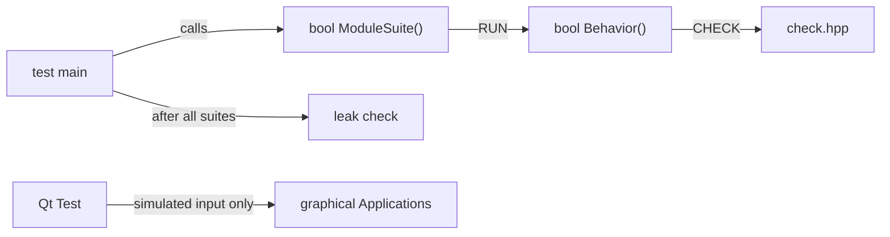

# Own test framework
## Context
<!-- The situation and the forces that make a decision necessary. -->
The Library may not depend on external code, while its tests are no part of it. The original implementation and the partial rewrite test with a small framework of their own, `check.hpp`, in C++: with templates and overloads, one `CHECK` compares numbers, strings, optionals and variants, prints them when they differ, and the runner checks for memory leaks. A framework in C99 would need a separate check for every type, because C99 has no way to tell types apart in a macro. A future maintainer may one day have nothing but a C compiler.

## Design
<!-- The parts involved, their responsibilities, and how they work together, e.g. as a flowchart or sequence diagram. -->

| Part | Responsibility |
| ---: | :--- |
| `tests/framework/check.hpp` | `CHECK`, `CHECK_EXCLUDE`, `RUN`, suites, printing of values that differ, and the leak check; carried over from the partial rewrite |
| Unit tests of the Library | C++ code that calls the C API of the Library, written with `check.hpp` |
| End-to-end tests | run the Command Line Application, written with `check.hpp` |
| Qt Test | simulated input for the graphical Applications, and nothing else |

## Justification
<!-- A sound reasoning why this design was chosen, including the conditions under which it holds. -->
`check.hpp` does what the tests need with very little code and no dependency, and the author knows it. C++ compilers will exist as long as C compilers do, as GCC and clang build both. In the extreme case of a future maintainer with nothing but a C compiler, the tests cannot run, but nothing is lost: the requirements describe exactly what the Library must do, every test names the requirement it checks, and the C++ tests stay readable as examples. What has to survive is the documentation, from which the tests can be written again; the tests themselves are derived from it.

## Consequences
<!-- What becomes easier or harder because of this design, including new obligations and risks. -->
The tests need a C++ compiler next to the C99 compiler of the Library. The framework is maintained by the project; features it lacks, e.g. test discovery or parameterized tests, have to be added by hand when needed. The graphical Applications need Qt Test in addition.

## See Also
 - [ADR 0002](adr_0002.md) why only the Library is free of dependencies
 - [ADR 0012](adr_0012.md) the end-to-end tests

-----
## Discussions
<!-- TEMPLATE
### Topic
NAME
> COMMENT
-->
