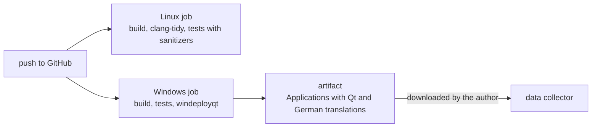

# Continuous integration with GitHub Actions
## Context
<!-- The situation and the forces that make a decision necessary. -->
The author develops on Linux, while the data collector uses Windows. The Library and the Applications have to run on both ([REQ 0038](../requirements/req_0038.md)). The Applications need Qt, which has to be bundled with them on Windows ([ADR 0010](adr_0010.md)). The original implementation already built on several platforms with GitHub Actions.

## Design
<!-- The parts involved, their responsibilities, and how they work together, e.g. as a flowchart or sequence diagram. -->

| Part | Responsibility |
| ---: | :--- |
| Linux job | builds everything with clang, runs clang-tidy, and runs all tests with AddressSanitizer and LeakSanitizer |
| Windows job | builds everything with clang, runs all tests, and bundles the Applications with `windeployqt`, the German Qt translations and the license texts |
| Artifact | the ready folder of the Windows job, downloaded by the author and passed on to the data collector |
| Workflow | `.github/workflows/`, carried over from the original implementation and extended |

## Justification
<!-- A sound reasoning why this design was chosen, including the conditions under which it holds. -->
The author never has to build on Windows himself, while every change is still checked to build and pass the tests there. The artifact is a working version for the data collector at any time, made the same way every time, so nothing is forgotten when bundling Qt. GitHub Actions is free for this use and was already in use.

## Consequences
<!-- What becomes easier or harder because of this design, including new obligations and risks. -->
The project depends on GitHub for building the Windows version, but not for building the Library, which still builds with nothing but a C99 compiler ([REQ 0039](../requirements/req_0039.md)). If GitHub Actions disappears, the Windows version has to be built on Windows by hand, as the workflow describes. Artifacts are kept for a limited time only, so a version passed on to the data collector should be kept by the author as well.

## See Also
 - [ADR 0010](adr_0010.md) the Applications in C++ with Qt
 - [DEP 0006](../dependencies/dep_0006.md) GitHub Actions

-----
## Discussions
<!-- TEMPLATE
### Topic
NAME
> COMMENT
-->
