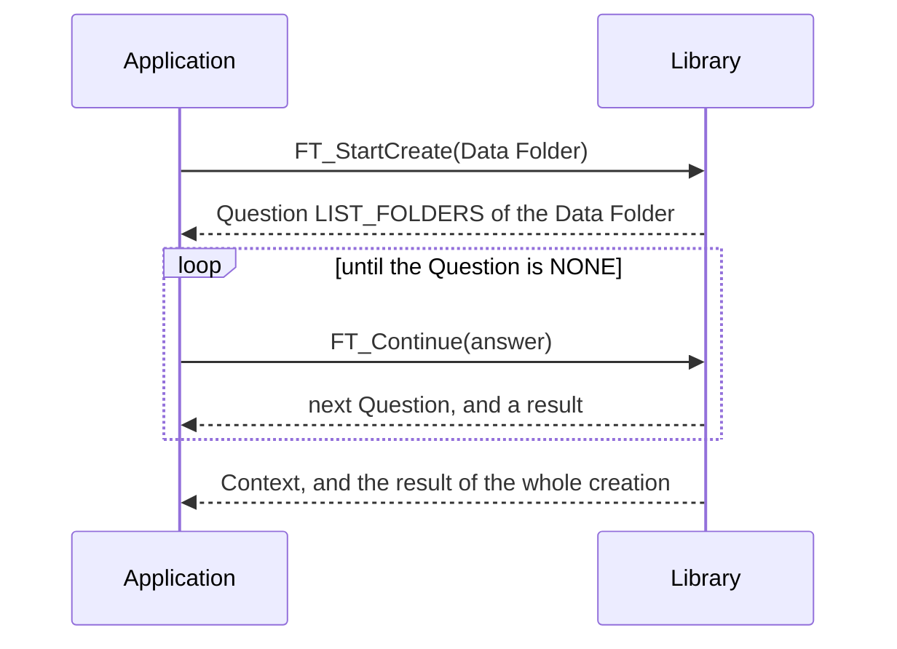

# Details of the creation and the Format Versions
## Context
<!-- The situation and the forces that make a decision necessary. -->
Writing the unit tests from the requirements raised questions that [ADR 0005](adr_0005.md) and [ADR 0017](adr_0017.md) leave open: which result the question loop ends with, what the first Question is, how paths are written, how problems in the data are reported, and which UUIDs the new Format Versions get. This record adds the answers; it replaces nothing.

## Design
<!-- The parts involved, their responsibilities, and how they work together, e.g. as a flowchart or sequence diagram. -->

| Part | Responsibility |
| ---: | :--- |
| First Question | `FT_StartCreate` never finishes a creation: it always returns the Question to list the folders of the Data Folder, so every creation can be cancelled with `FT_CancelCreate` |
| Result of the creation | the call that ends the creation, the last `FT_Continue` or `FT_Create`, returns `FT_OK_WITH_WARNINGS` if a warning was reported at any time during the creation, not only during that call; an Application only has to look at the last result |
| Paths | the paths in Questions and the Media paths join the Data Folder and the relative parts with `/`, which Windows accepts as well |
| Subtraces | every call of a public function opens one Subtrace at depth 0, so a creation through Questions shows one first line per call |
| Problems in the data | reported as warnings: a skipped Person File, a missing or skipped Relations File ([REQ 0049](../requirements/req_0049.md)), a skipped key, value or row ([REQ 0051](../requirements/req_0051.md)), and missing Media |
| Empty Details | an empty text or list in the Person File is present, and `FT_IsDefaultString` tells it apart from a missing one, see [ADR 0017](adr_0017.md) ([REQ 0050](../requirements/req_0050.md)) |
| Format Versions | Person File `1F10B769-08DE-442F-85BA-737B7F2B4803`, Relations File `227E82BA-6603-426C-9C95-5BC86A10A642`; the old Person File version `3B5589D2-D9AF-40A8-BC40-574DAB6FFC57` is not supported |

## Justification
<!-- A sound reasoning why this design was chosen, including the conditions under which it holds. -->
A result that covers the whole creation matches what `FT_Create` returns, so both ways of creating a Context behave the same, and an Application cannot miss a warning reported in an earlier call. Asking first, without exception, keeps the start of the loop free of special cases. `/` is the only separator both operating systems accept. Reporting problems in the data as warnings follows [ADR 0008](adr_0008.md): the Library works around them and says so. The two UUIDs were generated at random, as every Format Version is.

## Consequences
<!-- What becomes easier or harder because of this design, including new obligations and risks. -->
The Builder has to remember whether a warning was reported during the creation. Paths handed to an Application on Windows contain `/`, which has to be kept in mind when showing them to the user. The Data Entry Tool writes the Person File Format Version of this record, and has to change together with the Library when it changes.

## See Also
 - [ADR 0005](adr_0005.md) Questions instead of callbacks
 - [ADR 0006](adr_0006.md) Media paths, and the check for missing Media during the creation
 - [ADR 0017](adr_0017.md) Public API of the Library

-----
## Discussions
<!-- TEMPLATE
### Topic
NAME
> COMMENT
-->

### Errors during the creation
Andreas Edmeier
> Settled while implementing the Library Skeleton, 2026-11-16: a call of `FT_Continue` that returns an error leaves the Builder exactly as it was before the call, with the same Question open; nothing of the failed call remains, also not its warnings. The Application answers the Question again, e.g. after fixing a file, or stops with `FT_CancelCreate`. Only a creation that ends with a Context frees the Builder. `FT_Create` cancels its own Builder on an error. The documentation of `FT_Continue` and `FT_CancelCreate` in `api.h` says the same, and [ADR 0019](adr_0019.md) describes the rollback.
