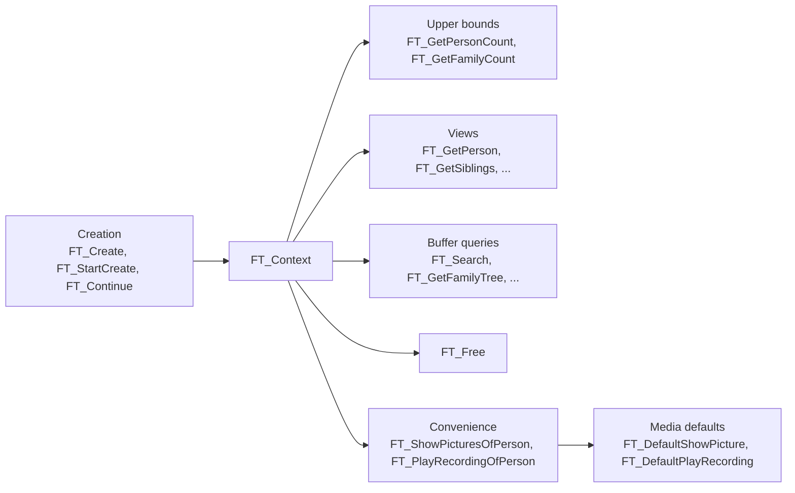

# Public API of the Library
## Context
<!-- The situation and the forces that make a decision necessary. -->
[ADR 0003](adr_0003.md) to [ADR 0009](adr_0009.md) decide how the Library is built: an immutable Context, views and caller buffers, Questions instead of callbacks, Media paths, a Trace as a text buffer, result codes, and the Family Tree query. [ADR 0013](adr_0013.md) turned them into concrete functions for the unit tests; the public header now exists and is the specification of the API ([REQ 0043](../requirements/req_0043.md)).

This record replaces ADR 0013 to tell an empty Detail apart from a missing one ([REQ 0050](../requirements/req_0050.md)): ADR 0013 gave an empty list the default string, and read an empty list in an answer as missing, so "known not to exist" could not be expressed for lists. The rest is unchanged; the declarations moved into the header.

## Design
<!-- The parts involved, their responsibilities, and how they work together, e.g. as a flowchart or sequence diagram. -->

| Part | Responsibility |
| ---: | :--- |
| Creation | turns a Data Folder into a Context, either in one call with the Default Platform, or through Questions the Application answers |
| Upper bounds | the sizes that every caller buffer can be allocated with once |
| Views | return `const` pointers into the Context; valid until `FT_Free` |
| Buffer queries | fill caller buffers in a single call; fail with `FT_ERROR_BUFFER_TOO_SMALL` and fill nothing if a buffer is smaller than the upper bound the function names |
| Media defaults | open a Picture or a Recording with the program of the operating system; the plain functions need no Context, the convenience functions look up the paths of a Person first |

Rules for every function:
- Every function returns `FT_Result` and takes an optional `FT_Trace*` as its last parameter; a null pointer means no Trace.
- Output parameters are only written when the function returns `FT_OK` or `FT_OK_WITH_WARNINGS`.
- All text is UTF-8 and zero terminated. Text inside the Context is never a null pointer: a missing Detail points to the Context's default string, an empty text, which `FT_IsDefaultString` recognizes by its address. Copying it is safe, but a copy is an ordinary empty text that `FT_IsDefaultString` no longer recognizes.
- A Detail that is empty in the Person File is present, not missing: an empty text points to an empty text that is not the default string. A list is never a null pointer either: with a count of 0, `items[0]` is the default string if the list is missing, and an empty text that is not the default string if the list is empty in the Person File. A list of Places of Residence with a count of 0 has one placeholder in `items[0]`, whose texts are all the default string or all such an empty text, in the same way.
- In an answer to a parsing Question, a null text, and a list whose `items` is a null pointer, mean missing; an empty text, and a list with `items` set and a count of 0, mean present but empty.
- `FT_PersonId` is the Person Id of the Person File; the Library never assigns ids of its own. An Application gets Person Ids from a search; a search without search texts and a minimum of 0 matches returns every Person.
- `FT_FamilyIndex` counts from 0 to the number of Families minus 1, because Families have no id in the data.
- A Relation that refers to a Person Id without a Person File, or to a skipped Person File, is left out with a warning.

The declarations, with their documentation, are in [library/include/family_tree/api.h](../../library/include/family_tree/api.h).

## Justification
<!-- A sound reasoning why this design was chosen, including the conditions under which it holds. -->
The API follows the earlier decisions without exception: no function pointers, no allocation after creation, one result type, and an optional Trace everywhere. Every buffer has an upper bound that is known before the call, so no function has to be called twice. `FT_Create` keeps simple Applications simple, while `FT_StartCreate` and `FT_Continue` give full control to Applications that read the data in their own way. Details are plain texts, safe to print without any check, and `FT_IsDefaultString` answers the rarer question whether one is missing, as `IsDefaultString` did in the original implementation; the default string is empty, because the Applications show missing Details in their own words and language. The answers to parsing Questions are the same structs the Library's own parsers return, so the Builder treats both alike; they reuse `FT_Person` and `FT_Relation`, and only add what a file holds beyond them: the Format Version and the paths of the Media.

## Consequences
<!-- What becomes easier or harder because of this design, including new obligations and risks. -->
Every value comes back through an output parameter, which makes calls longer. Family indices are only meaningful within one Context. The Data Entry Tool does not use the Library, so it has to know the current Format Version of the Person File itself. An Application that shows Details has to tell three cases apart: a value, "known not to exist", and missing; `FT_IsDefaultString` on the text, or on `items[0]` of an empty list, makes the difference.

## See Also
 - [ADR 0004](adr_0004.md) views and caller buffers
 - [ADR 0005](adr_0005.md) Questions instead of callbacks
 - [ADR 0018](adr_0018.md) the Trace
 - [ADR 0008](adr_0008.md) the result codes
 - [ADR 0009](adr_0009.md) the Family Tree query
 - [ADR 0016](adr_0016.md) details of the creation

-----
## Discussions
<!-- TEMPLATE
### Topic
NAME
> COMMENT
-->
