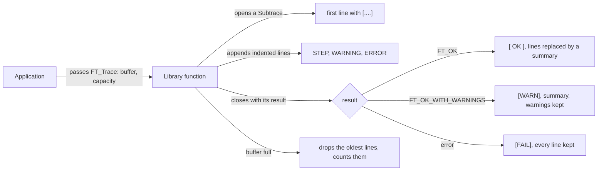

# Compacting Trace as a text buffer
## Context
<!-- The situation and the forces that make a decision necessary. -->
The original implementation passed a Trace object of function pointers to every function, and created a no-op Trace when none was given. Function pointers are forbidden ([ADR 0011](adr_0011.md)), and the Context allocates nothing after its creation ([ADR 0003](adr_0003.md)). The Trace viewer of the original implementation was needed because its log format was hard to read ([REQ 0044](../requirements/req_0044.md)). What made the original Trace valuable were its Subtraces: each showed whether it succeeded, so a successful branch could be skipped without reading it.

This record replaces [ADR 0007](adr_0007.md), which kept every line of every Subtrace, and dropped the newest lines once the buffer was full. When the Library is implemented, the Trace is used to find the cause of a warning or a failure; the inside of a successful Subtrace is not needed for that, and keeping it fills the buffer early. When lines have to be dropped, the last reports before a failure are the ones needed to debug it, not the first reports of the Trace. The format of the lines, the outcomes and the indentation stay as in ADR 0007.

## Design
<!-- The parts involved, their responsibilities, and how they work together, e.g. as a flowchart or sequence diagram. -->


| Part | Responsibility |
| ---: | :--- |
| FT_Trace | a struct of a character buffer, its capacity, the number of characters used, the number of dropped lines, and the number of open Subtraces; provided by the Application, filled with zeros except for the buffer and its capacity |
| Subtrace | one task of the Library, e.g. reading a Person File; its first line holds its outcome, the function and a short description; its lines are indented by one tab per depth |
| Outcome | `[....]` while the Subtrace is open; then `[ OK ]`, `[WARN]` or `[FAIL]`, written into the first line when the Subtrace closes; it is taken from the result the function closes the Subtrace with, so a dropped warning line cannot turn into `[ OK ]` |
| Line | one report within a Subtrace: the level (STEP, WARNING or ERROR) and the message; newlines, carriage returns and tabs within a message are written as spaces, so that every report stays one line |
| Summary | one STEP line that replaces the steps and the nested `[ OK ]` Subtraces of a closed Subtrace, with their numbers, e.g. `12 steps, 3 Subtraces`; left out if there was nothing to replace |
| Finding the first line | when a Subtrace closes, its first line is the last line indented by one tab less than the open depth; the Trace writer finds it by going backwards from the end of the buffer, so no positions are stored |
| Closing with `[ OK ]` | keeps the first line and the summary; everything else of the Subtrace is removed |
| Closing with `[WARN]` | keeps the first line, the summary, every WARNING line, and every nested `[WARN]` Subtrace as it was compacted when it closed |
| Closing with `[FAIL]` | keeps every line still in the Subtrace; nested Subtraces that closed before are already compacted |
| Dropping lines | when a line does not fit, whole lines are removed from the beginning of the buffer, at least a quarter of the capacity at a time, and the rest of the text is moved to the front; an open Subtrace whose first line was dropped gets no outcome written when it closes; a line larger than the whole buffer is dropped itself |
| Separators | tabs, for the indentation and between the fields of a line, so that a line can be split into its fields, and indentation costs one byte per depth |
| No Trace | a null pointer or a capacity of 0; passed on unchanged to the Trace writer, which does nothing for it, so no other function checks for it |
| Trace writer | the only internal functions that touch the Trace: open a Subtrace, report a step, a warning or an error, close a Subtrace with a result, close it with an error, and finish the Trace |
| Finishing | every public function finishes the Trace right before it returns, after closing its Subtrace; with the linear buffer of this record it only checks that the text ends with its terminating zero, and it is the place where a later buffer layout, e.g. a ring, turns the buffer back into plain text |

Example of a creation call with one warning:

```
[WARN]	FT_Continue	answer to PARSE_PERSON_FILE
	STEP	4 steps, 1 Subtrace
	[WARN]	ReadPersonFile	2_Bernd/data.json
		STEP	9 steps
		WARNING	2_Bernd/data.json: unknown key "death"
```

## Justification
<!-- A sound reasoning why this design was chosen, including the conditions under which it holds. -->
A buffer needs no function pointer and no allocation. Plain text lines can be read without any tool, written to a file, and searched with standard tools. Writing the outcome into the first line keeps the strength of the original Trace: the outcome is visible without reading the Subtrace, and editors that fold by indentation show exactly the first lines with their outcomes. A Subtrace that still shows `[....]` after a crash shows where the Library stopped. The outcome field has a fixed width, so it can be filled in later without moving text. Finding the first line from the indentation needs no stored positions, which also survive no drop, and costs nothing extra, because closing walks over the lines of the Subtrace anyway. Compacting successful Subtraces keeps what is needed to find the cause of a warning or a failure, and frees the space that would otherwise force lines to be dropped. Dropping the oldest lines keeps the reports closest to a failure. Removing a quarter of the capacity at a time moves the text rarely, so a long Trace does not cost a move per line. Taking the outcome from the result keeps the Trace and the return value in agreement, also when lines were dropped. A Trace of capacity 0 discards everything, which is exactly the behavior without a Trace. Since only the Trace writer touches the Trace, a single check there covers both cases, and the rest of the Library neither checks for a Trace nor formats text for a missing one.

## Consequences
<!-- What becomes easier or harder because of this design, including new obligations and risks. -->
The steps of successful work are gone once their Subtrace closes, so a wrong result without any warning cannot be followed through the Trace; finding such a cause needs a debugger or a test. Every function that opens a Subtrace has to close it with its true result, and has to pass a warning on in its result. The Application chooses the size of the buffer, and loses the oldest lines when it is too small; the count of dropped lines tells it so. A report cannot span several lines, as line breaks within its text become spaces. The Library formats and moves text, which costs a little time even when nobody reads it; nothing is formatted without a Trace or with a capacity of 0. No code outside the Trace writer may read or write the fields of `FT_Trace`.

## See Also
 - [ADR 0008](adr_0008.md) Result codes, warnings and errors
 - [ADR 0011](adr_0011.md) Power of Ten rules for the Library

-----
## Discussions
<!-- TEMPLATE
### Topic
NAME
> COMMENT
-->

### A ring buffer instead of dropping a quarter
Andreas Edmeier
> Discussed while implementing the Library Skeleton, 2026-11-17, and possibly wanted later: the Trace writer could write in a ring, ending the text with a zero, and keep the last byte of the buffer at zero while the text has not wrapped, so that a non-zero last byte tells that it has. Finishing the Trace at the end of a public call would then turn the ring back into plain text: skip to the first whole line after the zero, rotate the buffer so that this line comes first, and clear the bytes after the text, so that the last byte is zero again. Nothing more is freed; the following calls may wrap again right away. Every access within the ring goes character by character and takes its index modulo the capacity, so the end of the buffer never shows: compacting a Subtrace that lies across it works exactly like compacting one that does not. Compared with dropping a quarter while writing, it keeps every line a single long call writes, e.g. `FT_Create` with a small buffer, at the same cost for many short calls. The finishing call exists already, so the change stays inside the Trace writer.
