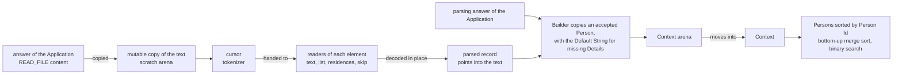

# Internal structure of the Library
## Context
<!-- The situation and the forces that make a decision necessary. -->
While a Context is created, the Library collects many small pieces: the decoded texts of every Person File and every Relation, the items of the lists, and the Persons themselves. Part of it is thrown away again when a file turns out to be malformed halfway through or has an unsupported Format Version. What is kept has to stay at a fixed address, because views point into it ([ADR 0004](adr_0004.md)), and `FT_Free`, as well as every failed creation, has to release all of it ([REQ 0042](../requirements/req_0042.md), [REQ 0047](../requirements/req_0047.md)); the original implementation leaked exactly there. The parsers have to decode escape sequences, check UTF-8, skip single keys, values and rows, and refuse malformed files ([REQ 0003](../requirements/req_0003.md), [REQ 0013](../requirements/req_0013.md), [REQ 0051](../requirements/req_0051.md)), without recursion and function pointers ([ADR 0011](adr_0011.md)). Person Ids need not be consecutive, so a Person is found through an index, and `qsort` and `bsearch` take function pointers.

## Design
<!-- The parts involved, their responsibilities, and how they work together, e.g. as a flowchart or sequence diagram. -->

| Part | Responsibility |
| ---: | :--- |
| Arena | an allocator that owns a linked list of large memory blocks, e.g. 64 kilobytes each, and gives out memory by moving a pointer forward within the current block; an object larger than a block gets a block of its own; it never frees single objects, so pointers into it never move |
| Mark and reset | a mark remembers the current position of an arena; resetting to it throws away everything allocated after it |
| Freeing an arena | frees its blocks, and nothing else |
| Rollback | at the start of every call of `FT_Continue`, the Builder sets a mark in both arenas and keeps a copy of its own state, e.g. the open Question, the current Person Folder and whether a warning came up; on an error it resets both arenas to their marks and restores the copy, so the Builder is as it was before the call ([ADR 0016](adr_0016.md#errors-during-the-creation)) |
| Scratch arena | owned by the Builder; holds the text of the file being read and what is parsed from it; reset after every file |
| Context arena | owned by the Builder while the creation runs, and moved into the Context when it succeeds; holds everything the Context keeps; `FT_Free` and every failed creation free it with its blocks |
| Copy of an accepted Person | the Builder copies a Person it accepts from the scratch arena into the Context arena, and fills in the Default String for every missing Detail; a Person parsed by the Library and a Person parsed by the Application go through the same copy |
| Mutable text | the Builder copies the text of an answer to READ_FILE into the scratch arena; this copy is the text of the parsing Question, and the Library's parsers decode it in place, as a decoded string is never longer than its encoded form, and write a zero after each string, so the parsed record points into the text |
| Tokenizer | a cursor over the text with its position, a stack of the open brackets of fixed depth, e.g. 64, the name of the file for warnings, and the Trace; each call returns the next token: a bracket, a colon, a comma, a string, a number, true, false or null; every token consumes at least one character, so every loop is bounded by the length of the text; a deeper nesting than the stack, or a closing bracket that does not match, is malformed |
| Readers | one function for each element of the Person File, e.g. a text, a list of texts, the Places of Residence, one Place of Residence, and skipping a value; each takes the cursor, and decides what a token means in its own context, e.g. whether a string is a value or a wrong type |
| CSV parser | a loop over the characters with a flag for being within quotation marks; unquotes fields in place, as a doubled quotation mark only shrinks |
| Person index | the Persons of the Context sorted by Person Id with a bottom-up merge sort, which merges runs of length 1, 2, 4 and so on with a working array from the scratch arena; it is stable, so Persons with the same Person Id keep the order in which they were read; a Person is found by binary search |

## Justification
<!-- A sound reasoning why this design was chosen, including the conditions under which it holds. -->
An arena cannot leak piece by piece, and rolling a failed call back is a reset to two marks: every path, successful or failed, ends by freeing the block lists, so no free path has to mirror the allocation paths. A file that is skipped costs nothing, because the scratch arena is reset, and the Context arena only ever receives what is kept. Handing the cursor to the reader of each element keeps the shape of the Person File visible in the code, needs no tree of JSON values, and needs no recursion, because nested values that are not read are skipped with the bracket stack. Decoding in place needs no memory beyond the copy of the text that the Builder has to make anyway, since an answer is freed once `FT_Continue` returns ([ADR 0005](adr_0005.md)). A bottom-up merge sort is iterative, runs in O(n log n), and is stable; a binary search over the sorted Persons finds a Person in O(log n) without allocating.

## Consequences
<!-- What becomes easier or harder because of this design, including new obligations and risks. -->
Every accepted Person is copied once. The arena is code of its own that has to be right, and memory errors within an arena are not visible to the sanitizers in the same detail as separate allocations. Warnings about a Person File are written while it is read, so a file that turns out malformed near its end has warnings about earlier keys in the Trace before the warning that it was skipped. The readers are written by hand for the shape of the Person File, so a new key needs a change in the reader. The merge sort needs a working array as large as the Persons during the creation.

## See Also
 - [ADR 0003](adr_0003.md) Immutable Context
 - [ADR 0005](adr_0005.md) Questions instead of callbacks
 - [ADR 0011](adr_0011.md) Power of Ten rules for the Library
 - [ADR 0017](adr_0017.md) Public API of the Library

-----
## Discussions
<!-- TEMPLATE
### Topic
NAME
> COMMENT
-->
