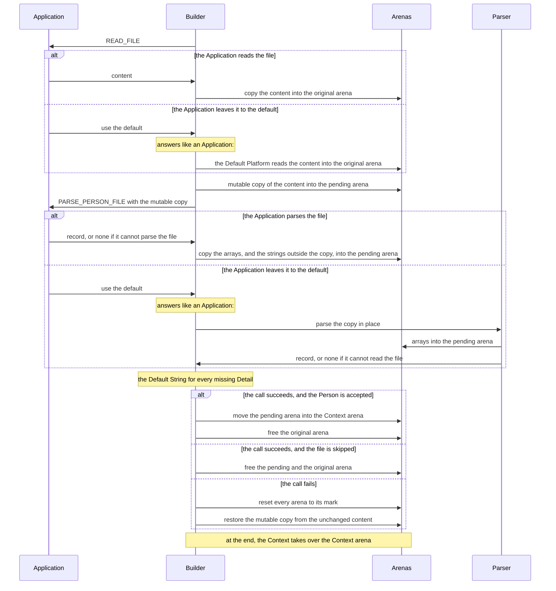

# Internal structure of the Library
## Context
<!-- The situation and the forces that make a decision necessary. -->
While a Context is created, the Library collects many small pieces: the decoded texts of every Person File and every Relation, the items of the lists, and the Persons themselves. Part of it is thrown away again when a file turns out to be malformed halfway through or has an unsupported Format Version. What is kept has to stay at a fixed address, because views point into it ([ADR 0004](adr_0004.md)), and `FT_Free`, as well as every failed creation, has to release all of it ([REQ 0042](../requirements/req_0042.md), [REQ 0047](../requirements/req_0047.md)); the original implementation leaked exactly there. The parsers have to decode escape sequences, check UTF-8, skip single keys, values and rows, and refuse malformed files ([REQ 0003](../requirements/req_0003.md), [REQ 0013](../requirements/req_0013.md), [REQ 0051](../requirements/req_0051.md)), without recursion and function pointers ([ADR 0011](adr_0011.md)). Person Ids need not be consecutive, so a Person is found through an index, and `qsort` and `bsearch` take function pointers.

## Design
<!-- The parts involved, their responsibilities, and how they work together, e.g. as a sequence diagram of how they interact, an entity relationship diagram of what each part holds, or a state diagram of a part with states. -->

| Part | Responsibility |
| ---: | :--- |
| Arena | a list of allocations that are freed together, newest first; every allocation is one node, allocated with `malloc`: a header that links to the previous node, followed by exactly the bytes asked for; the header is as large as the strictest alignment, so the bytes suit every type; it never frees single allocations, and nothing in it ever moves |
| Mark and reset | a mark remembers the newest node of an arena; resetting to it frees every node allocated after it |
| Freeing an arena | frees all its nodes |
| Rollback | every call of `FT_Continue` sets a mark in every arena of the Builder, and works on a copy of the Builder's state, e.g. the open Question, the current Person Folder and whether a warning came up; the copy replaces the state only if the call succeeds; on an error every arena is reset to its mark, and the text of an open parsing Question is restored from the unchanged content, so the Builder is as it was before the call ([ADR 0016](adr_0016.md#errors-during-the-creation)) |
| Scratch arena | owned by the Builder, for every temporary piece of data that has no arena of its own, e.g. the paths of the Questions, the Persons read so far, of which the Context keeps a sorted copy, the values of an array while the parser reads it, the array of Relations until the Context copies each Relation to its Persons, and the working array of the sort; freed when the creation is over, successfully or not |
| Original arena | owned by the Builder; holds the unchanged content of the file being read: copied from the answer of the Application, or read there by the Default Platform; freed when the call that answers its parsing Question succeeds, as the Question will not be answered again |
| Context arena | owned by the Builder while the creation runs, and taken over by the Context when it succeeds; holds everything the Context keeps, e.g. the names of the Person Folders; `FT_Free` and every failed creation free it |
| Pending arena | owned by the Builder; holds what the file being read adds to the Context if it is accepted: the mutable copy that is the text of its parsing Question, and the arrays and copied strings of its record; when a call succeeds, an accepted file is moved into the Context arena by linking the oldest node of the pending arena to the newest node of the Context arena, and a skipped file is freed; both happen only when a call succeeds, so that a failed call never frees memory the restored state still refers to |
| Copying an answer | right where `FT_Continue` tells an answer of the Application from one left to the default, the answer of the Application is copied into the arenas where the default puts its own: the folder names into the Context arena, the content of a file into the original arena, and a parsed record with its arrays into the pending arena; a string that starts and ends within the mutable copy stays where it is; the array of Relations goes into the scratch arena; afterwards the answer holds only the fields of the open Question, and each of its pointers is a null pointer or points into the arenas of the Builder, so that nothing after the copy can tell it from an answer of the default; an empty list points to an empty array of the Library, which tells it apart from a missing one ([ADR 0020](adr_0020.md)) |
| Answer by default | the Default Platform and the Library's own parsers put their results straight into the same arenas, so nothing of the default is copied: the folder names into the Context arena, the content of a file into the original arena, the arrays of a Person into the pending arena, and the array of Relations into the scratch arena; without folders, the folder names are a null pointer, and so is the content of a file that was not found, as in a copied answer |
| Completing an accepted Person | the Builder handles every answer alike, as it lies in its arenas whoever gave it: an answer to a parsing Question without a record skips the file; every missing Detail gets the Default String; an array is kept, and a missing text within it gets the Default String in place, as every array of an answer lies in the arenas of the Builder and was allocated within the call, so that a rollback frees it; the same holds for the Relations |
| Mutable text | the content of a file that is read lands unchanged in the original arena: copied from the answer of the Application, or read there directly by the Default Platform; the pending arena gets a mutable copy of it, which is the text of the parsing Question; the Library's parser, or the Application, decodes the mutable copy in place, as a decoded string is never longer than its encoded form, and a zero after each string ends it, so the parsed record points into the text; the unchanged content restores the text after a failed call, so that the Question can be answered again |
| JSON parser | parses a Person File in place, as a tokenizer without state, a driver that owns the grammar of JSON and a stack of frames, and one kind of frame for each part of the Person File, see [ADR 0021](adr_0021.md) |
| CSV parser | splits the text into lines in place first, as a line break always ends a row, and collects them in an array in the scratch arena; then splits each line into fields with a loop over its characters that knows about quotation marks, and unquotes them in place, as a doubled quotation mark only shrinks |
| Person index | the Persons of the Context sorted by Person Id with a bottom-up merge sort, which merges runs of length 1, 2, 4 and so on with a working array from the scratch arena; it is stable, so Persons with the same Person Id keep the order in which they were read; a Person is found by binary search |

## Justification
<!-- A sound reasoning why this design was chosen, including the conditions under which it holds. -->
An arena cannot leak piece by piece, and rolling a failed call back is a reset to marks: every path, successful or failed, ends by freeing the lists, so no free path has to mirror the allocation paths. One `malloc` for each allocation is fast enough for a few thousand Persons, needs no rounding of sizes, and lets the sanitizers check every allocation on its own. A file that is skipped costs nothing, because the pending arena is freed, and the Context arena only ever receives what is kept. Moving or freeing a file only when a call succeeds keeps the rollback a plain reset to marks. Decoding in place needs no memory beyond the copies of the text: the Builder has to copy an answer anyway, since it is freed once `FT_Continue` returns ([ADR 0005](adr_0005.md)), and the Question has to be answerable again after a failed call, which the unchanged copy allows. Keeping the decoded copy in the Context leaves nothing to copy once a Person is accepted, whether the Library or the Application parsed it in place. Copying the answer of an Application at the one place where it is told from the default, into the arenas where the default puts its own, leaves the rest of the Builder a single kind of answer, which lies in memory of the Builder, and no need to tell who gave it. A bottom-up merge sort is iterative, runs in O(n log n), and is stable; a binary search over the sorted Persons finds a Person in O(log n) without allocating.

## Consequences
<!-- What becomes easier or harder because of this design, including new obligations and risks. -->
The Context keeps the decoded text of every file it read, with its unknown keys and whitespace, i.e. a few megabytes for thousands of Persons. Every file exists twice while it is read: unchanged in the original arena, and as the mutable copy, which is copied once from the unchanged content; the content an Application read is copied once more from its answer. None of the texts is copied again, unless an Application parses the file into memory of its own; its strings are then copied before the Builder knows whether it keeps them, e.g. those of a Relation that names an unknown Person. Moving the pending arena walks to its oldest node, a few nodes per file. Everything in the scratch arena stays until the creation is over, mainly paths and the values of arrays, i.e. some hundreds of kilobytes for thousands of Persons; each arena of the Builder holds data of one lifetime, so none of them has to free single allocations. Every allocation costs one call of `malloc` and `free`, and the header of a node besides the bookkeeping of `malloc`. Warnings about a Person File are written while it is read, so a file that turns out malformed near its end has warnings about earlier keys in the Trace before the warning that it was skipped; so does a file whose "Version" key of an unsupported Format Version follows other keys, as the parser stops only there ([TDR 0001](../issues/tdr_0001.md)). The merge sort needs a working array as large as the Persons during the creation.

## See Also
 - [ADR 0003](adr_0003.md) Immutable Context
 - [ADR 0005](adr_0005.md) Questions instead of callbacks
 - [ADR 0011](adr_0011.md) Power of Ten rules for the Library
 - [ADR 0020](adr_0020.md) Public API of the Library
 - [ADR 0021](adr_0021.md) JSON parser of the Library

-----
## Discussions
<!-- TEMPLATE
### Topic
NAME
> COMMENT
-->
