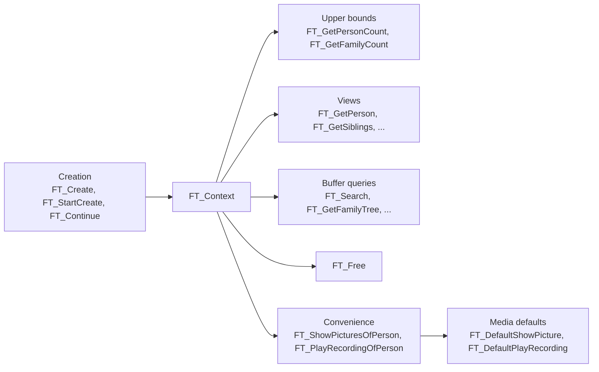

# Public API of the Library
## Context
<!-- The situation and the forces that make a decision necessary. -->
[ADR 0003](adr_0003.md) to [ADR 0009](adr_0009.md) decide how the Library is built: an immutable Context, views and caller buffers, Questions instead of callbacks, Media paths, a Trace as a text buffer, result codes, and the Family Tree query. [ADR 0013](adr_0013.md) turned them into concrete functions for the unit tests; the public header now exists and is the specification of the API ([REQ 0043](../requirements/req_0043.md)).

ADR 0017 replaced [ADR 0013](adr_0013.md) to tell an empty Detail apart from a missing one ([REQ 0050](../requirements/req_0050.md)). This record replaces [ADR 0017](adr_0017.md), because the text of a parsing Question was read only: an Application that parsed a file itself had to put its strings into memory of its own, and the Library copied every one of them, while the Library's own parser decodes the strings in place, in a copy of the file it keeps ([ADR 0019](adr_0019.md)). The text of a parsing Question is now such a copy, which the Application may decode in place as well, and an Application can also say that it could not parse a file, which before only the Library's own parser could. A parsing Question also names the file it is about, which before only the Library's own parser knew. A parsed record no longer holds the Format Version: whoever parses a file checks it before reading the rest. The rest is unchanged.

## Design
<!-- The parts involved, their responsibilities, and how they work together, e.g. as a flowchart or sequence diagram. -->

| Part | Responsibility |
| ---: | :--- |
| Creation | turns a Data Folder into a Context, either in one call with the Default Platform, or through Questions the Application answers |
| Upper bounds | the sizes that every caller buffer can be allocated with once |
| Views | return `const` pointers into the Context; valid until `FT_Free` |
| Buffer queries | fill caller buffers in a single call; fail with `FT_ERROR_BUFFER_TOO_SMALL` and fill nothing if a buffer is smaller than the upper bound the function names |
| Media defaults | open a Picture or a Recording with the program of the operating system; the plain functions need no Context, the convenience functions look up the paths of a Person first |

Rules for every function:
- Every function returns `FT_Result` and takes an optional `FT_Trace*` as its last parameter; a null pointer means no Trace.
- Output parameters are only written when the function returns `FT_OK` or `FT_OK_WITH_WARNINGS`.
- All text is UTF-8 and zero terminated. Text inside the Context is never a null pointer: a missing Detail points to the Context's default string, an empty text, which `FT_IsDefaultString` recognizes by its address. Copying it is safe, but a copy is an ordinary empty text that `FT_IsDefaultString` no longer recognizes.
- A Detail that is empty in the Person File is present, not missing: an empty text points to an empty text that is not the default string. A list is never a null pointer either: with a count of 0, `items[0]` is the default string if the list is missing, and an empty text that is not the default string if the list is empty in the Person File. A list of Places of Residence with a count of 0 has one placeholder in `items[0]`, whose texts are all the default string or all such an empty text, in the same way.
- In an answer to a parsing Question, a null text, and a list whose `items` is a null pointer, mean missing; an empty text, and a list with `items` set and a count of 0, mean present but empty.
- The text of a parsing Question is a copy of the file that belongs to the Library, and the Application may change it while it parses, e.g. decode its strings in place. The Library keeps every string of the answer that starts and ends within that text, without copying it; it copies every other string, and every array of the answer, before `FT_Continue` returns. If the call fails, the Library restores the text, so that the same Question can be answered again.
- A parsing Question has the path of the file whose content is its text, the same path as the READ_FILE Question before it, so that an Application that parses a file knows which one it is, e.g. to name it in messages, as the Library's own parsers do.
- Whoever parses a file checks its Format Version before it reads the rest, as the rest may mean something else in another Format Version, and answers without a record if it does not support it; the answer holds no Format Version. The Library's own parsers stop reading at a Format Version they do not support. As "Version" may follow other keys in a Person File, warnings about those keys can come first ([TDR 0001](../issues/tdr_0001.md)).
- An answer to PARSE_PERSON_FILE without a record means that the Application could not read the file, e.g. because it does not support its Format Version: the Library skips it with a warning, as it skips a file its own parser cannot read. An answer to PARSE_RELATIONS_FILE without Relations, i.e. a null pointer, skips the Relations File in the same way.
- When an Application leaves a Question to the default, the Library answers it the way an Application would, and then handles that answer like any other: the default has no means an Application lacks.
- `FT_PersonId` is the Person Id of the Person File; the Library never assigns ids of its own. An Application gets Person Ids from a search; a search without search texts and a minimum of 0 matches returns every Person.
- `FT_FamilyIndex` counts from 0 to the number of Families minus 1, because Families have no id in the data.
- A Relation that refers to a Person Id without a Person File, or to a skipped Person File, is left out with a warning.

The declarations, with their documentation, are in [library/include/family_tree/api.h](../../library/include/family_tree/api.h).

## Justification
<!-- A sound reasoning why this design was chosen, including the conditions under which it holds. -->
The API follows the earlier decisions without exception: no function pointers, no allocation after creation, one result type, and an optional Trace everywhere. Every buffer has an upper bound that is known before the call, so no function has to be called twice. `FT_Create` keeps simple Applications simple, while `FT_StartCreate` and `FT_Continue` give full control to Applications that read the data in their own way. Details are plain texts, safe to print without any check, and `FT_IsDefaultString` answers the rarer question whether one is missing, as `IsDefaultString` did in the original implementation; the default string is empty, because the Applications show missing Details in their own words and language. The answers to parsing Questions are the same structs the Library's own parsers return, so the Builder treats both alike; they reuse `FT_Person` and `FT_Relation`, and only add what a file holds beyond them: the paths of the Media. The Format Version tells how to read a file, so it belongs to reading it, not to its content: checking it first keeps a file of another Format Version from being read with the wrong rules, and an Application that reads another format altogether needs no Format Version of the Library to have its Persons accepted. A mutable text lets an Application parse a file in place, as the Library does, so that the strings of a file are not copied once more; strings from elsewhere, e.g. from a library that reads another format, are still accepted, and only cost a copy. Letting the default answer only as an Application could keeps a single path through the Library for both, so an Application that reads the data in its own way is never at a disadvantage, and the default can be tested through the same answers.

## Consequences
<!-- What becomes easier or harder because of this design, including new obligations and risks. -->
Every value comes back through an output parameter, which makes calls longer. The Library checks whether a string lies within the text by comparing addresses as integers, which every platform with flat memory supports; it copies each file once more before it asks to parse it, and keeps that copy for as long as the Context exists. Family indices are only meaningful within one Context. The Data Entry Tool does not use the Library, so it has to know the current Format Version of the Person File itself. An Application that parses files itself has to check their Format Version as well; when it skips a file, the Trace only says that the file could not be read, not why. An Application that shows Details has to tell three cases apart: a value, "known not to exist", and missing; `FT_IsDefaultString` on the text, or on `items[0]` of an empty list, makes the difference.

## See Also
 - [ADR 0004](adr_0004.md) views and caller buffers
 - [ADR 0005](adr_0005.md) Questions instead of callbacks
 - [ADR 0018](adr_0018.md) the Trace
 - [ADR 0008](adr_0008.md) the result codes
 - [ADR 0009](adr_0009.md) the Family Tree query
 - [ADR 0016](adr_0016.md) details of the creation
 - [ADR 0019](adr_0019.md) the internal structure, with the copy of each file the Context keeps
 - [TDR 0001](../issues/tdr_0001.md) warnings about keys before a late "Version" key

-----
## Discussions
<!-- TEMPLATE
### Topic
NAME
> COMMENT
-->

### Why the Default String stays empty
Andreas Edmeier
> Considered while reviewing the Library Skeleton, 2026-11-17: a visible placeholder such as "N/A", as a fallback for an Application that prints a Detail without checking `FT_IsDefaultString`. Rejected: it would help only when a Detail is shown and the check was forgotten, and everywhere else, e.g. when sorting, searching, exporting or saving Details, it would need a check of its own, and a forgotten check would go unnoticed, as the placeholder looks like data. An empty Default String does no harm wherever a check is forgotten.
