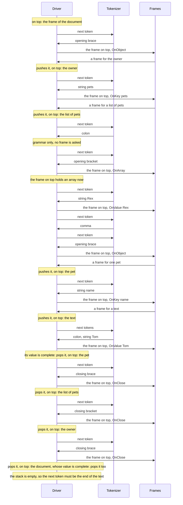
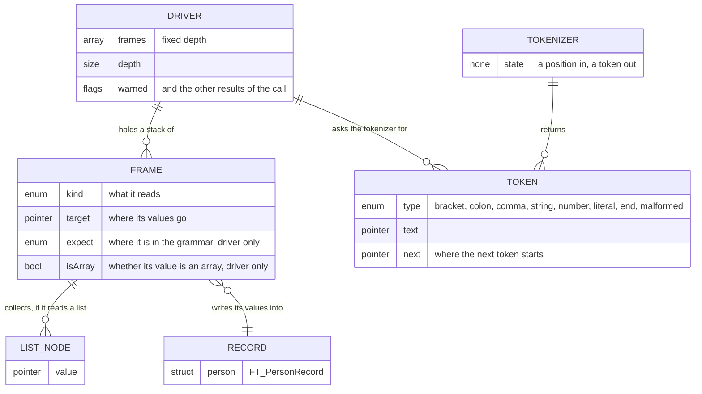
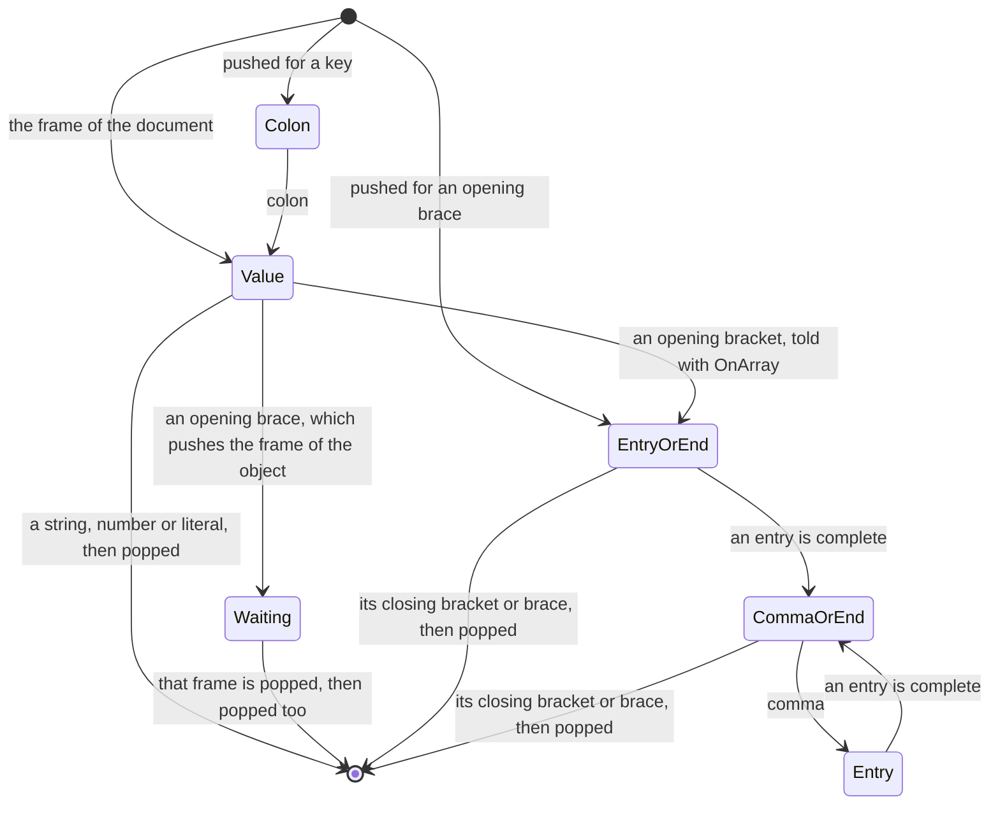

# JSON parser of the Library
## Context
<!-- The situation and the forces that make a decision necessary. -->
[ADR 0019](adr_0019.md) describes the JSON parser of the Person File as a tokenizer with a stack of the open brackets, and one reader function for each element of the Person File, which pulls tokens from it. The readers repeat the logic of what may come next in several loops, and the tokenizer and the readers share one struct, so the tokenizer, which needs to know nothing about the Person File, cannot be told apart from them in the code.

The original implementation had a stack of parsers instead, in which each key decided the parser of its value. It used callbacks and static mutable data for it, which [ADR 0011](adr_0011.md) forbids; the static data was recorded as technical debt and never solved.

## Design
<!-- The parts involved, their responsibilities, and how they work together, e.g. as a sequence diagram of how they interact, an entity relationship diagram of what each part holds, or a state diagram of a part with states. -->
How the three parts work together, for the made-up text `{"pets": ["Rex", {"name": "Tom"}]}`. The kinds of frames in it are only for the example; the Person File has its own:

What each part holds, and how they relate:

Where a frame is in the grammar of JSON, as the driver tracks it for each frame:

An entry is a key in an object, whose frame is pushed and popped again, and a value in an array: a string, number or literal, or an object, whose frame is pushed and popped again. Any token the current state does not accept makes the file malformed.

| Part | Responsibility |
| ---: | :--- |
| Tokenizer | finds the next token of JSON at a position in the text: a bracket, a brace, a colon, a comma, a string, a number, true, false or null, the end of the text, or malformed text; returns the token and where the next one starts; keeps no state, and knows nothing about the Person File; decodes a string in place, which never makes it longer, so the text after it is untouched; every token but the end consumes at least one character |
| Driver | one loop over the tokens, bounded by the length of the text; owns a stack of frames of fixed depth, e.g. 64, in the state of the call, which starts with the frame of the document; checks the grammar of JSON, which is the same for every object and array: after a key a colon, after a value a comma or the closing bracket or brace, and only the bracket or brace that opened a value closes it; notes for each frame where it is in that grammar, and whether its value is an array; a deeper nesting than the stack is malformed |
| Pushing and popping | the driver pushes the frame that the frame on top returns: for an object, and for the value of a key; it pops a frame for an object at its closing brace, and a frame for a value when the value is complete: after a string, number or literal, after the object that was its value, or at the closing bracket of the array that was its value; an array within an array, which no part of the Person File has, is told to the frame on top with OnArray as well, and read by a skipping frame that the driver pushes for it |
| Frames | one kind of frame for each part of the Person File: the document, the Person, one Place of Residence, the Format Version, the Person Id, a text, a list of texts, the list of Places of Residence, and a value that is skipped; a frame knows what its part means, and nothing about commas, colons or brackets |
| Questions to a frame | the driver tells the frame on top what arrives, and each is a `switch` over the kind of the frame: OnObject, an object arrives, and the frame returns the frame that reads it; OnKey, a key arrives, and the frame returns the frame that reads its value, as the key says what is expected; OnArray, a notice that the value is an array, so that the frame can check its type, and knows that a list is present even if it stays empty; OnValue, a string, number or literal arrives; OnClose, the closing bracket or brace of the frame arrives |
| Wrong types | a frame warns and skips a value of the wrong type: a frame for a text that gets OnArray, or OnObject, for which it returns a skipping frame; a frame for a list that gets OnValue without OnArray before; an item of the wrong type makes a frame for a list skip the whole list; the keys and values of a skipped value are skipped as well |
| Lists of unknown length | a frame of a list collects its values in a linked list in the scratch arena, as their number is not known before the closing bracket; when it closes, it allocates its array once, in the arena where the record goes, and copies the values into it |

The rest of [ADR 0019](adr_0019.md) is unchanged: the arenas, the mutable text, the CSV parser, and the index of Persons.

## Justification
<!-- A sound reasoning why this design was chosen, including the conditions under which it holds. -->
Splitting the parser into a tokenizer without state, a driver that owns the grammar of JSON, and frames that own the meaning of each part keeps each of them small: the grammar exists once for every object and array, the meaning of a key exists once in the frame of its object, and a value nobody reads is a frame like any other. It keeps the idea of the original implementation, a stack in which each key decides what reads its value, without what made it hard to keep: a `switch` over the kind of a frame needs no function pointers, and makes the compiler point out a kind that is not handled; the stack of frames is part of the state of the call, so nothing is static; and one loop over the tokens needs neither recursion nor a tree of JSON values.

## Consequences
<!-- What becomes easier or harder because of this design, including new obligations and risks. -->
The frames are written by hand for the shape of the Person File, so a new key needs a case in the frame of its object, and a new kind of value a new kind of frame. A frame gets one token at a time and cannot read on by itself, so whatever it has read so far, e.g. the values of a list, is kept in the frame. Warnings are written while the file is read, so a file that turns out malformed near its end has warnings about earlier keys in the Trace before the warning that it was skipped. The parser of the Library skeleton follows the previous design of ADR 0019 and has to be rebuilt.

## See Also
 - [ADR 0011](adr_0011.md) no recursion, no function pointers, a fixed upper bound for every loop
 - [ADR 0019](adr_0019.md) the internal structure of the Library, with the arenas the parser uses
 - [ADR 0020](adr_0020.md) the parsed record, and the Format Version checked before the rest

-----
## Discussions
<!-- TEMPLATE
### Topic
NAME
> COMMENT
-->

### The Trace of the parser, and a file it cannot read
Andreas Edmeier
> Settled while rebuilding the parser of the Library Skeleton, 2026-11-19. The parser reads a Person File in a Subtrace of its own, and every frame reads its part in a nested Subtrace, which the driver opens when it pushes the frame and closes when it pops it, so that the Trace keeps the shape of the stack, and a part read without problems is compacted as soon as it is complete; this keeps the Trace small while a file is read, also for an Application with a small buffer. The driver writes one step for each token: where it is, what it is, and what the frame on top expects; the frames write a step in each of their branches, and before their work, but none that repeats what a Subtrace or the step for the token already says. A frame closes its Subtrace with warnings if a warning was written while it was on the stack. A file that cannot be read into a record, e.g. malformed, of a Format Version that is not supported or missing, without a Person Id, or in UTF-16, is a failure of the parser ([ADR 0022](adr_0022.md)), which takes the place of an output parameter that told whether a record was read; the reason is written into the frame on top where reading stopped, and the frames still open close their Subtraces with the failure as well, as none of them could read its part, so that the path to where reading stopped keeps every step. The Builder works around the failure with an answer without a record, which it skips with a warning like every such answer ([ADR 0020](adr_0020.md)). The parser of the Relations File reads in a Subtrace of its own as well, and fails in the same way for a file it cannot read; a row it cannot read is still skipped with a warning.
