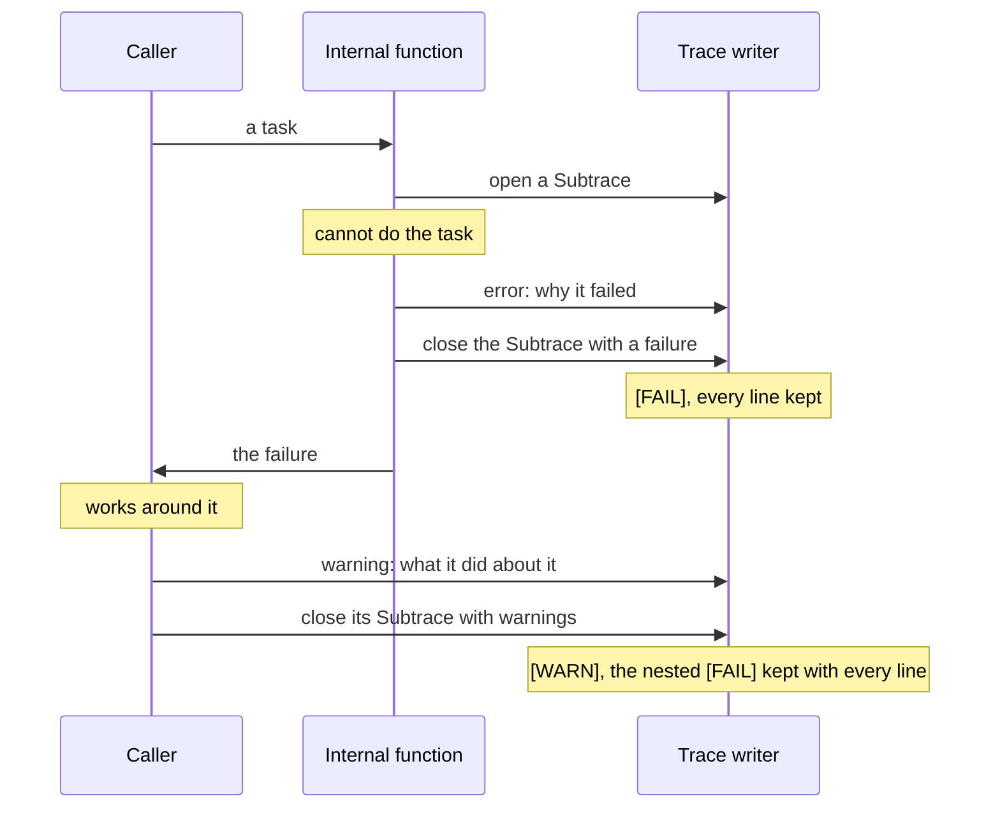

# Internal result of the Library
## Context
<!-- The situation and the forces that make a decision necessary. -->
A function that cannot do what it was asked returns an error ([ADR 0008](adr_0008.md)), and the outcome of its Subtrace is taken from the result it closes it with ([ADR 0018](adr_0018.md)). Both are stated for `FT_Result`, the result of the public functions. The parsers of the Library could not report that they failed to read a file: they returned `FT_OK_WITH_WARNINGS` and told the Builder through an output parameter that they had no record, because the creation goes on without the file ([REQ 0013](../requirements/req_0013.md)), and every error of an answer makes the Builder roll the answer back. Their Subtraces therefore closed with `[WARN]`, and compacting removed exactly the steps that show where a file broke. An error code for this in `FT_Result` would become part of the public API, although it never reaches an Application, and every value would have to be defined for Applications before it is needed.

## Design
<!-- The parts involved, their responsibilities, and how they work together, e.g. as a sequence diagram of how they interact, an entity relationship diagram of what each part holds, or a state diagram of a part with states. -->
How a failure of an internal function passes through the parts, within the Subtrace of a public function:

| Part | Responsibility |
| ---: | :--- |
| Result | the return value of every internal function that reports whether it did its task; it never leaves the Library; it holds the public results that internal functions need, and failures that only internal functions report; a value is added when a function needs it, not before |
| Own task | every function judges its own task: it returns a failure when it cannot do what it was asked, also when its caller works around it, and reports why as an error; the caller decides how to go on, and reports what it does about it, as a warning if it works around the failure |
| PublicResult | turns a Result into the `FT_Result` of a public function: each value with a public counterpart into that counterpart; a failure that has no public counterpart has to be handled by the caller before, which an `assert` checks |
| TraceCloseResult | closes a Subtrace with a Result, as `TraceClose` does with an `FT_Result`: `[ OK ]`, `[WARN]`, or `[FAIL]` for every failure; the outcome is taken from the result, as before |

## Justification
<!-- A sound reasoning why this design was chosen, including the conditions under which it holds. -->
Letting each function judge its own task keeps the meaning of an outcome the same at every depth of the Trace: `[FAIL]` says that this function did not do what it was asked, and `[WARN]` that it did, around problems in the data. The caller that works around a failure is the one that knows how, so it reports that, and its own outcome is a warning. A failed Subtrace keeps every line, and a Subtrace that closes with warnings keeps a nested failed one, so the steps of the work that failed stay in the Trace, while those of the work that succeeded are compacted. An internal type keeps the failures out of the public API: Applications see only `FT_Result`, which does not grow with every reason an internal function may fail, and a value is defined when the function that needs it is written. A separate closing function keeps the Trace writer's rule that the outcome comes from the result, without converting a failure into an unrelated public error just to close a Subtrace.

## Consequences
<!-- What becomes easier or harder because of this design, including new obligations and risks. -->
Every internal function that returns a Result needs its caller to handle each failure that has no public counterpart before it reaches a public function; `PublicResult` only catches a forgotten one in a debug build. There are two closing functions in the Trace writer, one per result type. A failure that the caller works around still leaves every step of the failed Subtrace in the Trace, which can be long when the failed work was large.

## See Also
 - [ADR 0008](adr_0008.md) result codes, warnings and errors of the public functions
 - [ADR 0018](adr_0018.md) the Trace writer, and the outcome taken from the result

-----
## Discussions
<!-- TEMPLATE
### Topic
NAME
> COMMENT
-->
