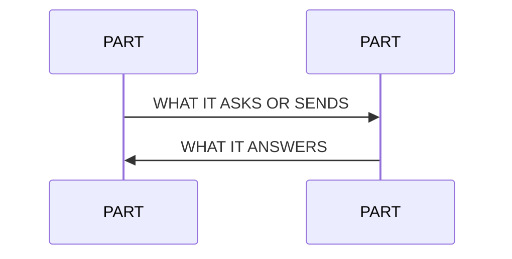

# <!-- TITLE --> TEMPLATE
## Context
<!-- The situation and the forces that make a decision necessary. -->

## Design
<!-- The parts involved, their responsibilities, and how they work together, e.g. as a sequence diagram of how they interact, an entity relationship diagram of what each part holds, or a state diagram of a part with states. -->

<!-- TEMPLATE
| Part | Responsibility |
| ---: | :--- |
| NAME | what it does, and where its responsibility ends |
-->

## Justification
<!-- A sound reasoning why this design was chosen, including the conditions under which it holds. -->

## Consequences
<!-- What becomes easier or harder because of this design, including new obligations and risks. -->

<!-- TEMPLATE
## See Also
 - [ADR 0000](adr_0000.md) reason why this is related
-->

-----
## Discussions
<!-- TEMPLATE
### Topic
NAME
> COMMENT
-->
